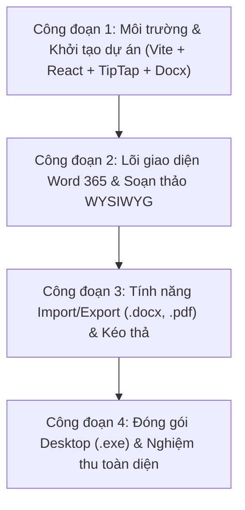

# KẾ HOẠCH PHÁT TRIỂN ỨNG DỤNG PC DOC EDITOR (MICROSOFT WORD 365 EDITION)

- **Dự án**: PC Doc Editor (Ứng dụng soạn thảo, đọc và chỉnh sửa file văn bản .docx trên PC)
- **Thư mục lưu trữ**: `c:\workspace\ai_project\doc_app`
- **Ngày lập**: 22/11/2026
- **Điều phối**: Coordinator Agent | **Thực thi**: Coder Agent | **Kiểm thử**: Tester Agent | **Thẩm định**: Reviewer Agent

---

## 1. MỤC TIÊU VÀ YÊU CẦU ỨNG DỤNG

Xây dựng ứng dụng Desktop hoàn chỉnh trên máy tính cá nhân để **đọc, soạn thảo, định dạng và lưu file văn bản Word (.docx)** với giao diện và trải nghiệm tương tự Microsoft Word 365.

### Các tính năng cốt lõi bắt buộc:
1. **Giao diện chuẩn Microsoft Word 365**:
   - Thanh tiêu đề (TitleBar) màu xanh lam đặc trưng `#185ABD` hoặc `#2B579A`.
   - Thanh truy cập nhanh (Quick Access Toolbar): Tạo mới, Mở file, Lưu, In/PDF, Undo, Redo.
   - Khung xem trang tài liệu (Document Page View): Khổ giấy trắng A4 chuẩn, có bóng đổ (drop-shadow), lề trang (margins), mô phỏng như trang in của Word.
2. **Thanh công cụ Ribbon đa năng (4 Thẻ Ribbon)**:
   - **Trang đầu (Home)**:
     + Phông chữ (Font Family: Segoe UI, Aptos, Times New Roman, Arial, Calibri, Roboto...).
     + Cỡ chữ (Font Size: 8pt - 72pt), nút tăng/giảm cỡ chữ nhanh.
     + Định dạng chữ: **In đậm (Ctrl+B)**, *In nghiêng (Ctrl+I)*, <u>Gạch chân (Ctrl+U)</u>, Gạch ngang chữ, Chỉ số dưới ($X_2$), Chỉ số trên ($X^2$).
     + Màu chữ (Font Color), Màu bút dạ quang đánh dấu (Text Highlight Color).
     + Căn lề: Căn trái (Left), Căn giữa (Center), Căn phải (Right), Căn đều hai bên (Justify).
     + Giãn dòng (Line spacing: 1.0, 1.15, 1.5, 2.0, 2.5).
     + Danh sách: Danh sách dấu đầu dòng (Bullet list), Danh sách đánh số (Numbered list), Danh sách kiểm tra (Task list).
     + Kiểu văn bản (Styles): Tiêu đề 1 (Heading 1), Tiêu đề 2 (Heading 2), Tiêu đề 3 (Heading 3), Văn bản thường (Normal paragraph).
   - **Chèn (Insert)**:
     + Chèn Bảng biểu (Table): Tạo bảng tùy biến số hàng/cột, thêm/xóa hàng cột, gộp ô.
     + Chèn Hình ảnh (Image): Tải ảnh từ PC vào văn bản, căn chỉnh kích thước ảnh.
     + Chèn Đường kẻ ngang phân cách (Divider / Horizontal Rule).
     + Chèn Khối trích dẫn (Blockquote), Khối mã lập trình (Code block).
     + Chèn Liên kết (Hyperlink).
   - **Bố trí trang (Layout)**:
     + Căn lề trang (Margins: Bình thường, Thu hẹp, Rộng).
     + Hướng giấy: Dọc (Portrait) / Ngang (Landscape).
   - **Xem & Thống kê (View)**:
     + Chế độ hiển thị: Trang in (Page View) / Chế độ đọc toàn màn hình (Reading View).
     + Thu phóng trang (Zoom: 50% - 200%).
3. **Thanh trạng thái dưới đáy (Status Bar)**:
   - Thống kê thời gian thực: Số trang (Page X of Y), Tổng số từ (Word count), Tổng số ký tự (Character count), Thời gian đọc ước tính.
   - Tỷ lệ thu phóng (Zoom slider).
4. **Xử lý Đọc & Ghi file chuẩn Microsoft Word**:
   - **Mở file (.docx)**:
     + Mở file `.docx` từ máy tính hoặc **kéo & thả (Drag and Drop)** trực tiếp file `.docx` vào cửa sổ ứng dụng.
     + Phân tích cú pháp và nạp đầy đủ văn bản, định dạng font, màu sắc, tiêu đề, danh sách, bảng biểu và hình ảnh.
   - **Lưu file (.docx)**:
     + Xuất ra file chuẩn định dạng OpenXML `.docx` tương thích 100% với Microsoft Word, Google Docs và LibreOffice.
   - **Xuất file PDF**: Hỗ trợ in hoặc xuất trực tiếp tài liệu ra định dạng `.pdf`.
5. **Hệ thống phím tắt chuẩn Word**:
   - `Ctrl + S`: Lưu file (.docx)
   - `Ctrl + O`: Mở file từ PC
   - `Ctrl + P`: In / Xuất PDF
   - `Ctrl + B` / `Ctrl + I` / `Ctrl + U`: Đậm / Nghiêng / Gạch chân
   - `Ctrl + L` / `Ctrl + E` / `Ctrl + R` / `Ctrl + J`: Căn Trái / Giữa / Phải / Đều
   - `Ctrl + Z` / `Ctrl + Y`: Hoàn tác / Làm lại
   - `Ctrl + A`: Chọn toàn bộ văn bản

---

## 2. PHÂN TÍCH VÀ LỰA CHỌN CÔNG NGHỆ

| Thành phần | Lựa chọn tối ưu | Lý do lựa chọn |
|---|---|---|
| **Nền tảng Desktop** | **Electron + React 18 + TypeScript + Vite** | Tận dụng sẵn môi trường Node.js LTS đã cài ở bước trước. Tốc độ build siêu nhanh, đóng gói được thành file `.exe` độc lập. |
| **Lõi soạn thảo (Editor Core)** | **TipTap (ProseMirror Engine)** | Bộ lõi soạn thảo văn bản phong phú WYSIWYG hàng đầu hiện nay, hỗ trợ hoàn hảo cấu trúc tài liệu DOM (Headings, Tables, Images, Lists, Text Styling, Alignments, History). |
| **Đọc file .docx (Import)** | **`mammoth`** hoặc **`docx-preview`** | Phân tích tài liệu Word phức tạp chuyển đổi chính xác sang HTML/ProseMirror JSON, giữ nguyên định dạng, bảng biểu và hình ảnh nhúng. |
| **Ghi file .docx (Export)** | **`docx` (npm)** | Thư viện tạo file `.docx` chuẩn OpenXML mạnh nhất hiện nay trong hệ sinh thái Node.js/JS, tạo file tương thích 100% với Microsoft Word thật. |
| **Bộ Icon** | **`lucide-react`** | Đầy đủ icon chuẩn văn phòng hiện đại. |

---

## 3. KẾ HOẠCH TRIỂN KHAI THEO 4 CÔNG ĐOẠN

### Công đoạn 1: Khởi tạo dự án (Setup)
- Tạo cấu trúc thư mục tại `c:\workspace\ai_project\doc_app`.
- Cấu hình `package.json`, TypeScript, Vite, Electron.
- Cài đặt dependencies: `@tiptap/react`, `@tiptap/starter-kit`, `@tiptap/extension-table`, `@tiptap/extension-image`, `@tiptap/extension-text-align`, `@tiptap/extension-color`, `@tiptap/extension-highlight`, `docx`, `mammoth`, `lucide-react`.

### Công đoạn 2: Giao diện Microsoft Word 365 & Lõi soạn thảo
- Thiết kế TitleBar (xanh lam Word `#185ABD`), Quick Access Bar.
- Thiết kế thanh Ribbon đầy đủ: Home (Font, Style, Align, List), Insert (Table, Image, Divider), Layout (Margins), View (Zoom).
- Tạo Document Canvas: Khổ giấy A4 trắng tinh tế, lề trang chuẩn.
- Tích hợp thanh Status Bar: Thống kê từ, ký tự, số trang, thanh zoom.

### Công đoạn 3: Tính năng Đọc & Ghi file Word (.docx, .pdf)
- Xây dựng module nạp file Word: Kéo thả file `.docx` hoặc bấm Mở file để hiển thị lên trang.
- Xây dựng module lưu file Word: Biên dịch nội dung sang cấu trúc `.docx` chuẩn OpenXML.
- Xây dựng tính năng xuất PDF qua Electron print API.

### Công đoạn 4: Kiểm thử, Thẩm định & Đóng gói (.exe)
- **Tester Agent**: Kiểm thử tạo file, format văn bản, chèn bảng/ảnh, kiểm tra round-trip mở và lưu file `.docx`.
- **Reviewer Agent**: Thẩm định code, tính an toàn IPC, bộ nhớ và UI/UX.
- **Đóng gói**: Tạo bản Portable `.exe` và Setup `.exe` trong thư mục `release/`.
- **Coordinator Agent**: Tổng duyệt nghiệm thu cuối cùng và bàn giao.

---

## 4. BẢNG CHECKLIST CHI TIẾT DỰ ÁN

Checklist chi tiết của dự án được lưu tại file riêng:  
👉 **`c:\workspace\ai_project\doc_app\CHECKLIST.md`**
