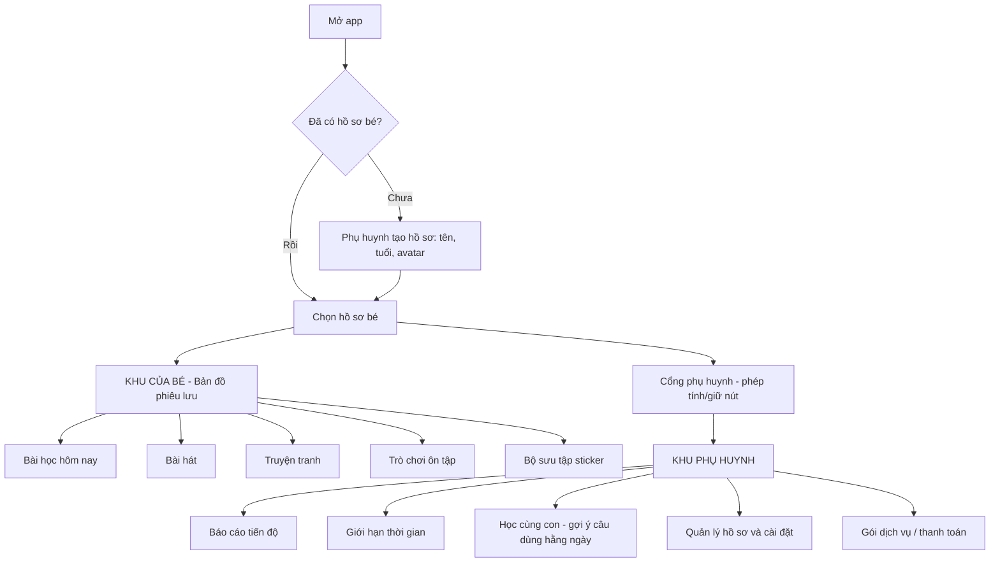
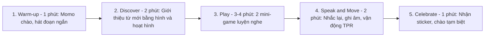
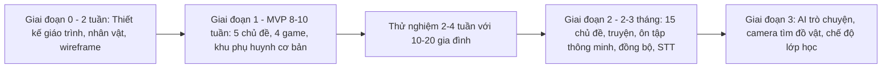

# BÁO CÁO PHÂN TÍCH & KHẢO SÁT
## Ứng dụng học tiếng Anh cho trẻ 4 tuổi – tên tạm: **"Bé Vui Tiếng Anh" (Little English Buddy)**

> Ngày lập: 23/11/2026
> Phạm vi: Phân tích đối tượng dùng, khảo sát thị trường, đề xuất chức năng, chương trình học (từ vựng + mẫu câu), cấu trúc bài học, nguyên tắc UI/UX, kỹ thuật và lộ trình phát triển.

---

## MỤC LỤC
1. [Tổng quan dự án](#1-tổng-quan-dự-án)
2. [Phân tích đối tượng sử dụng](#2-phân-tích-đối-tượng-sử-dụng)
3. [Khảo sát thị trường & đối thủ](#3-khảo-sát-thị-trường--đối-thủ)
4. [Nguyên tắc sư phạm & thiết kế](#4-nguyên-tắc-sư-phạm--thiết-kế)
5. [Đề xuất chức năng](#5-đề-xuất-chức-năng)
6. [Chương trình học đề xuất](#6-chương-trình-học-đề-xuất)
7. [Cấu trúc một bài học](#7-cấu-trúc-một-bài-học)
8. [Các dạng hoạt động / trò chơi](#8-các-dạng-hoạt-động--trò-chơi)
9. [Hướng dẫn UI/UX cho trẻ 4 tuổi](#9-hướng-dẫn-uiux-cho-trẻ-4-tuổi)
10. [Đề xuất kỹ thuật](#10-đề-xuất-kỹ-thuật)
11. [An toàn, quyền riêng tư & pháp lý](#11-an-toàn-quyền-riêng-tư--pháp-lý)
12. [Chỉ số đo lường (KPI)](#12-chỉ-số-đo-lường-kpi)
13. [Rủi ro & giải pháp](#13-rủi-ro--giải-pháp)
14. [Lộ trình phát triển](#14-lộ-trình-phát-triển)
15. [Kết luận & bước tiếp theo](#15-kết-luận--bước-tiếp-theo)

---

## 1. Tổng quan dự án

| Hạng mục | Nội dung |
|---|---|
| **Người học** | Trẻ 3.5 – 5 tuổi (trọng tâm 4 tuổi), tiếng mẹ đẻ là tiếng Việt |
| **Người mua / người quản lý** | Bố mẹ, ông bà, giáo viên mầm non |
| **Mục tiêu chính** | Trẻ **làm quen** với âm thanh tiếng Anh, **nghe hiểu & nói được** ~300 từ vựng thông dụng và ~60 mẫu câu giao tiếp hằng ngày |
| **Không phải mục tiêu** | Dạy đọc/viết, ngữ pháp, thi cử |
| **Nền tảng** | Ứng dụng di động (Android/iOS), ưu tiên **máy tính bảng** |
| **Triết lý** | "Học mà chơi – Nghe trước, nói sau – Ít mà chắc – Bố mẹ cùng tham gia" |

### Mục tiêu học tập cụ thể sau 6 tháng
- Nhận biết và gọi tên ~300 từ vựng thuộc 15 chủ đề gần gũi.
- Nghe hiểu và phản hồi ~60 câu thường dùng (chào hỏi, xin phép, cảm ơn, giới thiệu bản thân…).
- Hát được 10–15 bài hát tiếng Anh thiếu nhi.
- Hình thành thói quen & thái độ tích cực với tiếng Anh (quan trọng nhất ở tuổi này).

---

## 2. Phân tích đối tượng sử dụng

### 2.1. Đặc điểm phát triển của trẻ 4 tuổi & hệ quả thiết kế

| Lĩnh vực | Đặc điểm | Hệ quả cho thiết kế app |
|---|---|---|
| **Khả năng chú ý** | Tập trung liên tục khoảng **5–10 phút** cho một hoạt động | Mỗi hoạt động 1–3 phút, mỗi bài học **≤ 10–12 phút** |
| **Đọc – viết** | **Chưa biết đọc** (cả tiếng Việt) | Giao diện **không phụ thuộc chữ**; mọi hướng dẫn bằng **giọng nói + hình ảnh + hoạt hình minh họa** |
| **Vận động tinh** | Chạm/kéo thả được, nhưng chưa chính xác; khó thao tác vuốt nhiều ngón, nhấn giữ lâu | Nút **to (≥ 64–80dp)**, khoảng cách rộng; ưu tiên **chạm** và **kéo thả đơn giản** |
| **Nhận thức** | Tư duy trực quan, cụ thể; học qua lặp lại, bắt chước; thích câu chuyện, nhân vật | Dùng **nhân vật linh vật** dẫn dắt; lặp lại có chủ đích (spaced repetition) |
| **Ngôn ngữ** | Đang hoàn thiện tiếng mẹ đẻ; giai đoạn vàng để tiếp nhận ngữ âm mới; có "giai đoạn im lặng" khi học ngôn ngữ thứ 2 | Ưu tiên **nghe nhiều**, không ép nói; khen khi trẻ cố gắng nói; giọng bản ngữ chuẩn, nói chậm, rõ |
| **Cảm xúc** | Dễ nản khi thất bại; cần khen ngợi ngay lập tức | **Không có "sai/thua"**, không trừ điểm; phản hồi nhẹ nhàng "Try again!" + gợi ý |
| **Xã hội** | Học hiệu quả nhất qua tương tác với người lớn | Thiết kế hoạt động **bố mẹ cùng chơi** và gợi ý "mang tiếng Anh ra đời thực" |

### 2.2. Chân dung người dùng (Persona)

**👧 Bé An – 4 tuổi**
- Thích hoạt hình, động vật, bài hát có vận động.
- Biết dùng điện thoại/máy tính bảng của mẹ để xem video.
- Chưa biết đọc, nhận biết màu sắc và đếm đến 10 bằng tiếng Việt.

**👩 Chị Lan – mẹ bé An, 32 tuổi, nhân viên văn phòng**
- Muốn con làm quen tiếng Anh sớm nhưng **tiếng Anh của bản thân không tốt**, ngại phát âm sai.
- Lo lắng con nghiện điện thoại, xem quảng cáo không phù hợp.
- Có 15–20 phút buổi tối để chơi cùng con.
- Cần: biết con học được gì, kiểm soát thời gian, nội dung an toàn, giá hợp lý.

### 2.3. Nhu cầu cốt lõi

| Trẻ | Phụ huynh |
|---|---|
| Vui, có nhân vật dễ thương, âm thanh sinh động | Nội dung **an toàn, không quảng cáo** |
| Được khen, nhận phần thưởng (sticker, sao) | **Giới hạn thời gian** sử dụng |
| Tự thao tác được không cần người lớn | **Báo cáo tiến độ** dễ hiểu |
| Bài hát, câu chuyện | Phát âm **chuẩn bản ngữ** |
| | Hướng dẫn để **cùng học với con** dù không giỏi tiếng Anh |

---

## 3. Khảo sát thị trường & đối thủ

### 3.1. Các ứng dụng tiêu biểu

| Ứng dụng | Độ tuổi | Điểm mạnh | Điểm yếu | Mô hình giá |
|---|---|---|---|---|
| **Monkey Junior** (VN) | 0–11 | Lộ trình bài bản, kho từ vựng lớn, AI chấm phát âm (M-Speak), có giải thích tiếng Việt | Thiên về học thuật/flashcard, ít yếu tố chơi; giá cao | Trả phí (gói năm/trọn đời) |
| **Lingokids** | 2–8 | Học qua chơi ("Playlearning"), bài hát và video chất lượng cao, chủ đề giao tiếp hằng ngày, có báo cáo cho phụ huynh | Bản miễn phí hạn chế; toàn tiếng Anh, không hỗ trợ tiếng Việt | Freemium + thuê bao |
| **Khan Academy Kids** | 2–8 | **Miễn phí 100%, không quảng cáo**, lộ trình thích ứng, nội dung toàn diện | Thiết kế cho trẻ bản ngữ, không phải ESL; không có tiếng Việt | Miễn phí (phi lợi nhuận) |
| **Babilala** (VN) | 3–10 | Gia sư AI tương tác, giáo trình cho trẻ Việt | Phụ thuộc nhận diện giọng nói (độ chính xác với trẻ nhỏ còn hạn chế) | Thuê bao |
| **Duolingo ABC** | 3–8 | Miễn phí, giao diện xuất sắc | Tập trung vào **đọc chữ/phonics** cho trẻ bản ngữ, không phải từ vựng giao tiếp | Miễn phí |
| **Super Simple / Cocomelon (YouTube)** | 1–6 | Bài hát rất hấp dẫn, miễn phí | Xem thụ động, có quảng cáo, không có lộ trình, dễ "nghiện" | Miễn phí (quảng cáo) |

### 3.2. Khoảng trống thị trường (cơ hội)
1. **Học qua chơi + lộ trình rõ ràng + hỗ trợ phụ huynh Việt**: Lingokids vui nhưng không có tiếng Việt; Monkey có tiếng Việt nhưng nặng flashcard.
2. **Công cụ cho bố mẹ "không giỏi tiếng Anh"**: rất ít app hướng dẫn bố mẹ cách dùng từ/câu đã học trong sinh hoạt hằng ngày.
3. **Sử dụng lành mạnh**: ít app chủ động **khuyến khích dừng lại** và chuyển sang hoạt động ngoài màn hình.
4. **Hoạt động offline / vận động (TPR)**: ít app kết hợp vận động cơ thể ("Jump!", "Clap your hands!").

### 3.3. Định vị đề xuất
> **"App tiếng Anh đầu đời cho bé Việt: chơi 10 phút mỗi ngày, bố mẹ cùng nói tiếng Anh với con suốt cả ngày."**

---

## 4. Nguyên tắc sư phạm & thiết kế

### 4.1. Cơ sở khuyến nghị
- **WHO**: trẻ 3–4 tuổi dùng màn hình **tối đa 1 giờ/ngày** (càng ít càng tốt), khuyến khích có người lớn cùng xem/tương tác.
- **Nghiên cứu "video deficit"**: trẻ nhỏ học ngôn ngữ từ màn hình kém hơn nhiều so với tương tác người thật → app cần **thúc đẩy tương tác với bố mẹ**, không thay thế bố mẹ.
- **Thiết kế có trách nhiệm**: không autoplay vô tận, không hiệu ứng "máy đánh bạc", không quảng cáo, không mua hàng trong khu vực trẻ.

### 4.2. Phương pháp giảng dạy áp dụng

| Phương pháp | Ứng dụng trong app |
|---|---|
| **Input-first (nghe trước)** | Mỗi từ được nghe 6–10 lần trong 1 bài, ở nhiều ngữ cảnh khác nhau |
| **TPR – Total Physical Response** | Trẻ làm theo lệnh bằng cơ thể: "Touch your nose!", "Jump!", "Wave goodbye!" |
| **Học qua bài hát & vần điệu** | Mỗi chủ đề có 1 bài hát chủ đề |
| **Storytelling** | Truyện tranh tương tác ngắn ở cuối mỗi chủ đề, tái sử dụng từ/câu đã học |
| **Spaced Repetition** | Ôn lại từ cũ sau 1 – 3 – 7 – 14 ngày, lồng ghép tự nhiên vào trò chơi |
| **Ngữ cảnh hóa (chunks)** | Dạy câu nguyên khối ("Can I have…, please?") thay vì ngữ pháp |
| **Không dịch máy móc** | Hình ảnh là "nghĩa"; tiếng Việt chỉ dùng cho hướng dẫn và cho phụ huynh |

### 4.3. 10 nguyên tắc vàng
1. Mỗi phiên học **10–15 phút**, mặc định giới hạn **20–30 phút/ngày** (phụ huynh chỉnh được).
2. **Không chữ** trong luồng của trẻ (chữ chỉ xuất hiện kèm hình như “tiếp xúc thụ động”).
3. **Không thất bại**: sai thì gợi ý, không trừ điểm, không “Game over”.
4. **Một màn hình – một nhiệm vụ**, tối đa 3–4 lựa chọn.
5. **Giọng người bản ngữ thật** (không dùng TTS máy cho từ vựng chính).
6. Mỗi bài có ít nhất **1 hoạt động vận động** rời mắt khỏi màn hình.
7. Phần thưởng mang tính **khích lệ nội tại** (sticker, nhân vật nhảy múa) – không dùng vòng quay may mắn, hộp quà ngẫu nhiên.
8. **Không quảng cáo**, không link ra ngoài trong khu trẻ.
9. Kết thúc bài bằng **điểm dừng tự nhiên** ("Bye bye! See you tomorrow!").
10. Luôn có **gợi ý cho bố mẹ** áp dụng ngoài đời thực.

---

## 5. Đề xuất chức năng

App gồm **2 khu vực tách biệt**: **Khu của Bé** và **Khu Phụ huynh** (bảo vệ bằng "cổng phụ huynh" – parental gate).

### 5.1. Sơ đồ chức năng tổng quan



### 5.2. Danh sách chức năng chi tiết & mức ưu tiên

**Ký hiệu:** 🔴 MVP (bắt buộc bản đầu) · 🟡 Giai đoạn 2 · 🟢 Giai đoạn 3

#### A. Khu của Bé

| # | Chức năng | Mô tả | Ưu tiên |
|---|---|---|---|
| A1 | **Bản đồ phiêu lưu** | Màn hình chính dạng bản đồ/hòn đảo, mỗi chủ đề là 1 vùng; bé đi theo con đường, bài tiếp theo phát sáng | 🔴 |
| A2 | **Nhân vật dẫn dắt (Mascot)** | Linh vật (VD: chú khỉ **Momo**) chào hỏi, hướng dẫn bằng giọng nói, khen ngợi | 🔴 |
| A3 | **Bài học theo chủ đề** | Bài học 5 bước (xem mục 7) | 🔴 |
| A4 | **Thẻ từ vựng tương tác** | Chạm vào hình → nghe từ + câu ví dụ + hiệu ứng hoạt hình | 🔴 |
| A5 | **Mini-game** | 6–8 dạng game (xem mục 8) | 🔴 (4 dạng) / 🟡 |
| A6 | **Bài hát karaoke** | Video/hoạt hình bài hát, có chế độ hát theo | 🔴 |
| A7 | **Nghe & nhắc lại (Ghi âm)** | Bé nói, app ghi âm và phát lại giọng bé (có thể đổi giọng vui nhộn), không chấm điểm khắt khe | 🔴 |
| A8 | **Phần thưởng & bộ sưu tập** | Sao, sticker theo chủ đề, trang trí ngôi nhà của Momo | 🔴 |
| A9 | **Truyện tranh tương tác** | Truyện 6–10 trang, chạm vào nhân vật/đồ vật để nghe từ | 🟡 |
| A10 | **Ôn tập thông minh** | Trò chơi ôn tập tự động chọn từ cần ôn (spaced repetition) | 🟡 |
| A11 | **Hoạt động vận động (TPR)** | Video bắt chước động tác: "Clap, jump, spin!" | 🔴 |
| A12 | **Nhận diện giọng nói** | Phản hồi khi bé nói đúng từ (ngưỡng dễ, khuyến khích) | 🟡 |
| A13 | **Tô màu & vẽ** | Tô màu con vật/đồ vật, mascot gọi tên màu bằng tiếng Anh | 🟡 |
| A14 | **Trò chuyện cùng Momo (AI)** | Hội thoại đơn giản theo kịch bản, giới hạn từ vựng đã học | 🟢 |
| A15 | **Chế độ Camera "Tìm đồ vật"** | Bé đưa camera vào đồ vật thật (quả táo, cái ghế) → app gọi tên tiếng Anh | 🟢 |
| A16 | **Lời chúc ngủ ngon / Bedtime** | Truyện audio nhẹ nhàng trước khi ngủ, màn hình tối | 🟢 |

#### B. Khu Phụ huynh

| # | Chức năng | Mô tả | Ưu tiên |
|---|---|---|---|
| B1 | **Cổng phụ huynh** | Phép tính đơn giản/nhấn giữ 3 giây/đọc số bằng chữ để vào | 🔴 |
| B2 | **Hồ sơ bé** | Tạo tối đa 3–4 hồ sơ (anh chị em), không cần ảnh thật | 🔴 |
| B3 | **Giới hạn thời gian** | Đặt phút/ngày, khung giờ cho phép; hết giờ mascot "đi ngủ" | 🔴 |
| B4 | **Báo cáo tiến độ** | Số từ đã học, thời gian học, chủ đề hoàn thành, từ bé yêu thích | 🔴 |
| B5 | **Nghe lại giọng bé** | Nghe các bản ghi âm bé nói qua thời gian (lưu cục bộ) | 🟡 |
| B6 | **"Học cùng con" (Parent Coach)** | Mỗi bài có 3 câu bố mẹ nên dùng hằng ngày + file nghe phát âm + phiên âm tiếng Việt dễ đọc; gợi ý trò chơi ngoài đời | 🔴 |
| B7 | **Thông báo nhắc học** | Nhắc giờ học cố định cho phụ huynh (không gửi cho trẻ) | 🟡 |
| B8 | **Tải nội dung offline** | Tải trước chủ đề để dùng khi không có mạng | 🟡 |
| B9 | **Phiếu học / in ấn** | Flashcard PDF, tranh tô màu để in | 🟢 |
| B10 | **Đồng bộ đa thiết bị** | Đăng nhập tài khoản phụ huynh để đồng bộ tiến độ | 🟡 |
| B11 | **Thanh toán / gói dịch vụ** | Chỉ trong khu phụ huynh | 🟡 |
| B12 | **Chế độ lớp học** | Giáo viên mầm non chiếu lên TV, quản lý nhiều bé | 🟢 |

### 5.3. Phạm vi MVP đề xuất (bản đầu tiên)
- 5 chủ đề đầu tiên (≈ 60 từ, 15 mẫu câu), mỗi chủ đề 4 bài + 1 bài hát.
- 4 dạng mini-game: Chạm chọn hình, Kéo thả, Lật thẻ ghép đôi, Nghe & làm theo (TPR).
- Ghi âm – phát lại giọng bé.
- Bản đồ, mascot, sticker.
- Khu phụ huynh: cổng, hồ sơ, giới hạn thời gian, báo cáo cơ bản, "Học cùng con".
- Hoạt động offline hoàn toàn (nội dung đóng gói sẵn).

---

## 6. Chương trình học đề xuất

### 6.1. Tổng quan lộ trình (6 tháng – 3 cấp độ)

| Cấp độ | Thời gian | Mục tiêu | Chủ đề |
|---|---|---|---|
| **Level 1 – Hello! (Làm quen)** | Tháng 1–2 | Nghe & nhận biết; nói 1 từ | 1–5 |
| **Level 2 – My World (Thế giới của bé)** | Tháng 3–4 | Nói từ + cụm 2–3 từ | 6–10 |
| **Level 3 – Let's Talk (Cùng nói)** | Tháng 5–6 | Nói câu ngắn, hỏi – đáp đơn giản | 11–15 |

Nhịp học: **4–5 buổi/tuần × 10–15 phút**, mỗi chủ đề ≈ **2 tuần** (4 bài mới + ôn tập + bài hát + truyện).

### 6.2. Chi tiết 15 chủ đề – Từ vựng & Mẫu câu

#### 🟦 LEVEL 1 – HELLO!

**Chủ đề 1. Hello! – Chào hỏi & Bản thân**
- Từ vựng (8): hello, hi, goodbye/bye-bye, boy, girl, mommy, daddy, baby
- Mẫu câu:
  - *Hello! / Hi!* – *Goodbye! / Bye-bye!*
  - *What's your name?* → *I'm An. / My name is An.*
  - *How are you?* → *I'm fine, thank you.*
- Bài hát gợi ý: "Hello Song", "Goodbye Song"

**Chủ đề 2. Colors – Màu sắc**
- Từ vựng (10): red, blue, yellow, green, orange, pink, purple, black, white, brown
- Mẫu câu:
  - *What color is it?* → *It's red.*
  - *I like blue.*
- Bài hát: "I See Something Blue", "Rainbow Colors Song"

**Chủ đề 3. Numbers 1–10 – Số đếm**
- Từ vựng (10): one → ten
- Mẫu câu:
  - *How many?* → *Three!*
  - *Let's count! One, two, three…*
  - *I'm four (years old).*
- Bài hát: "Ten Little Fingers", "Five Little Monkeys"

**Chủ đề 4. Animals – Động vật (thân quen)**
- Từ vựng (12): dog, cat, bird, fish, duck, chicken, cow, pig, horse, rabbit, mouse, sheep
- Mẫu câu:
  - *What's this?* → *It's a dog.*
  - *The dog says "woof woof".*
  - *I like cats.*
- Bài hát: "Old MacDonald Had a Farm"

**Chủ đề 5. My Body – Cơ thể**
- Từ vựng (12): head, eyes, ears, nose, mouth, hair, hands, fingers, arms, legs, feet, tummy
- Mẫu câu (TPR):
  - *Touch your nose!* – *Clap your hands!* – *Stamp your feet!*
  - *This is my nose.*
- Bài hát: "Head, Shoulders, Knees and Toes"

#### 🟩 LEVEL 2 – MY WORLD

**Chủ đề 6. Family – Gia đình**
- Từ vựng (8): family, mommy, daddy, brother, sister, grandma, grandpa, baby
- Mẫu câu:
  - *Who is this?* → *This is my mommy.*
  - *I love you, Mommy!*
- Bài hát: "Finger Family"

**Chủ đề 7. Food & Fruits – Đồ ăn & Trái cây**
- Từ vựng (14): apple, banana, orange, mango, watermelon, grapes, rice, bread, egg, milk, water, juice, cake, candy
- Mẫu câu:
  - *I'm hungry. / I'm thirsty.*
  - *Can I have some milk, please?* → *Here you are.* → *Thank you!*
  - *Yummy! / I like apples. / I don't like…*
- Bài hát: "Do You Like Broccoli Ice Cream?", "Apples and Bananas"

**Chủ đề 8. Toys – Đồ chơi**
- Từ vựng (10): ball, doll, car, teddy bear, blocks, kite, robot, balloon, train, puzzle
- Mẫu câu:
  - *Let's play!*
  - *My turn! / Your turn!*
  - *Can I play with the ball?* – *Let's share.*
- Bài hát: "My Toys Song"

**Chủ đề 9. My House – Ngôi nhà**
- Từ vựng (12): house, door, window, bed, table, chair, TV, bathroom, kitchen, bedroom, sofa, lamp
- Mẫu câu:
  - *Where is the cat?* → *It's on the bed. / under the table.*
  - *Open the door, please. / Close the door.*
- Bài hát: "Where Is Thumbkin?"

**Chủ đề 10. Clothes – Quần áo**
- Từ vựng (10): shirt, T-shirt, pants, dress, shoes, socks, hat, jacket, skirt, pajamas
- Mẫu câu:
  - *Put on your shoes. / Take off your hat.*
  - *It's cold! / It's hot!*
- Bài hát: "Put On Your Shoes"

#### 🟨 LEVEL 3 – LET'S TALK

**Chủ đề 11. Feelings – Cảm xúc**
- Từ vựng (8): happy, sad, angry, scared, tired, sleepy, hungry, surprised
- Mẫu câu:
  - *How do you feel?* → *I'm happy!*
  - *Are you OK?* → *Yes. / No, I'm sad.*
- Bài hát: "If You're Happy and You Know It"

**Chủ đề 12. Daily Routines – Sinh hoạt hằng ngày**
- Từ vựng (10): wake up, brush teeth, wash hands, eat, drink, take a bath, go to school, play, sleep, good morning/good night
- Mẫu câu:
  - *Good morning! / Good night!*
  - *Wash your hands. / Brush your teeth.*
  - *Time to sleep. / Time to eat.*
- Bài hát: "This Is the Way We Brush Our Teeth"

**Chủ đề 13. Actions – Hành động**
- Từ vựng (12): run, jump, walk, sit down, stand up, dance, sing, swim, fly, climb, clap, sleep
- Mẫu câu:
  - *Can you jump?* → *Yes, I can!*
  - *Let's dance! / Stand up, please. / Sit down, please.*
- Bài hát: "Walking Walking", "Can You Move Like Me?"

**Chủ đề 14. Shapes & Sizes – Hình khối & Kích thước**
- Từ vựng (10): circle, square, triangle, star, heart, rectangle, big, small, long, short
- Mẫu câu:
  - *What shape is it?* → *It's a circle.*
  - *It's big! / It's small!*
- Bài hát: "The Shapes Song"

**Chủ đề 15. Nature & Weather – Thiên nhiên & Thời tiết**
- Từ vựng (12): sun, moon, star, cloud, rain, tree, flower, sky, sunny, rainy, windy, hot/cold
- Mẫu câu:
  - *How's the weather?* → *It's sunny!*
  - *Look! A rainbow!*
- Bài hát: "Rain Rain Go Away", "Twinkle Twinkle Little Star"

> **Tổng cộng: ~160 từ cốt lõi + từ mở rộng trong truyện/bài hát ≈ 300 từ.** Danh sách có thể mở rộng thêm các chủ đề: Phương tiện giao thông (Vehicles), Nghề nghiệp (Jobs), Trường học (School), Sinh nhật & Lễ hội (Birthday, Tết, Christmas), Động vật hoang dã (Zoo animals).

### 6.3. Bộ câu giao tiếp "Magic Words" xuyên suốt (học dần trong mọi chủ đề)

| Nhóm | Câu tiếng Anh | Ngữ cảnh sử dụng |
|---|---|---|
| Lịch sự | *Please. / Thank you. / You're welcome. / Sorry. / Excuse me.* | Mọi lúc |
| Xin phép | *Can I…, please? / May I go to the toilet?* | Ở nhà, ở trường |
| Đồng ý / Từ chối | *Yes, please. / No, thank you. / OK!* | Khi được mời |
| Trợ giúp | *Help me, please. / I can do it!* | Khi gặp khó |
| Khen | *Good job! / Well done! / Wow! / Great!* | Bố mẹ dùng khen bé |
| Chơi | *Let's play! / My turn. / Your turn. / I win! / Again!* | Khi chơi |
| Cảm xúc | *I love you. / I'm happy. / I'm tired.* | Gia đình |
| Chỉ dẫn | *Come here. / Look! / Listen! / Stop! / Wait!* | Hằng ngày |

---

## 7. Cấu trúc một bài học

Mỗi bài học **8–12 phút**, dạy **4–6 từ mới + 1 mẫu câu**, theo 5 bước:



| Bước | Mục tiêu | Ví dụ (Chủ đề Animals – Bài 1: dog, cat, bird, fish) |
|---|---|---|
| **1. Warm-up** | Tạo hứng thú, ôn 1–2 từ cũ | Momo: *"Hello, An! Let's go to the farm!"* + đoạn nhạc "Old MacDonald" |
| **2. Discover** | Tiếp nhận từ mới (nghe 3+ lần/từ) | Lần lượt con chó xuất hiện: *"Dog! It's a dog. Woof woof!"*, bé chạm để nghe lại |
| **3. Play** | Luyện nghe – nhận biết | Game "Tìm con vật": *"Where's the cat?"* – chạm đúng hình. Game "Cho con vật ăn" kéo thả |
| **4. Speak & Move** | Bắt chước nói & vận động | *"Say: Dog!"* → bé nói → app phát lại giọng bé. *"Fly like a bird!"* – bé vỗ tay như chim |
| **5. Celebrate** | Củng cố cảm xúc tích cực, điểm dừng | Nhận sticker "Chú chó", Momo nhảy múa: *"Great job! Bye-bye!"* |

**Sau mỗi bài → Khu phụ huynh nhận thẻ "Học cùng con":**
> 🏠 Hôm nay bé học: **dog, cat, bird, fish**
> 💬 Câu dùng ở nhà: *"Look! A cat!"* (Lúc! ờ két) – khi thấy mèo ngoài đường.
> 🎲 Trò chơi gợi ý: Bố mẹ giả tiếng kêu, bé đoán tên con vật bằng tiếng Anh.

---

## 8. Các dạng hoạt động / trò chơi

| # | Dạng trò chơi | Kỹ năng | Cách chơi | Độ khó |
|---|---|---|---|---|
| 1 | **Tap & Find (Chạm tìm hình)** | Nghe hiểu từ | Nghe *"Where's the apple?"* → chạm đúng 1 trong 2–4 hình | ⭐ |
| 2 | **Drag & Drop (Kéo thả)** | Nghe hiểu câu | *"Put the red ball in the box"* → kéo đúng | ⭐⭐ |
| 3 | **Memory Match (Lật thẻ)** | Ghi nhớ | Lật 4–6 thẻ tìm cặp giống nhau, mỗi lần lật nghe tên | ⭐⭐ |
| 4 | **Simon Says (TPR)** | Nghe + vận động | Momo ra lệnh, bé làm theo ngoài đời (không cần chạm màn hình) | ⭐ |
| 5 | **Pop the Balloon (Bắn bóng)** | Phản xạ nghe | Bóng bay mang hình; nghe từ → chạm bóng đúng | ⭐⭐ |
| 6 | **Feed the Animal (Cho ăn)** | Từ vựng đồ ăn + câu | *"The monkey wants a banana"* → kéo chuối vào miệng khỉ | ⭐⭐ |
| 7 | **Dress Up (Mặc đồ)** | Quần áo, màu sắc | *"Put on the blue hat"* → mặc đồ cho nhân vật | ⭐⭐ |
| 8 | **Repeat after Momo (Nhắc lại)** | Nói / phát âm | Nghe → nói → nghe lại giọng mình | ⭐⭐ |
| 9 | **What's Missing? (Cái gì biến mất)** | Ghi nhớ + nói | 3 đồ vật, 1 cái biến mất, bé chạm/nói tên | ⭐⭐⭐ |
| 10 | **Color It (Tô màu)** | Màu sắc | *"Color the apple red"* → tô | ⭐⭐ |
| 11 | **Count It (Đếm)** | Số đếm | Đếm số con vịt và chạm số lượng tương ứng (biểu diễn bằng chấm) | ⭐⭐ |
| 12 | **Story Time (Truyện)** | Nghe hiểu ngữ cảnh | Truyện tương tác, trả lời câu hỏi bằng cách chạm | ⭐⭐⭐ |

**Nguyên tắc độ khó thích ứng:** bắt đầu 2 lựa chọn → tăng lên 3–4 khi bé đúng liên tục; nếu bé sai 2 lần → mascot gợi ý (hình đúng nhấp nháy nhẹ) → giảm lại số lựa chọn.

---

## 9. Hướng dẫn UI/UX cho trẻ 4 tuổi

### 9.1. Giao diện
- **Kích thước vùng chạm**: tối thiểu 64dp, khuyến nghị 80–120dp cho đối tượng chính; khoảng cách ≥ 16dp.
- **Bố cục**: hướng ngang (landscape) trên tablet; tối đa 3–4 đối tượng tương tác mỗi màn hình.
- **Màu sắc**: tươi sáng nhưng **không chói**; nền dịu (pastel), đối tượng tương tác có màu nổi bật.
- **Biểu tượng thay chữ**: 🏠 về nhà, ▶️ chơi, 🔊 nghe lại; nút "Quay lại" luôn ở cùng một vị trí.
- **Phông chữ** (khi có chữ minh họa): sans-serif tròn, chữ thường (VD: Andika, Nunito, Baloo).
- **Không có menu ẩn, cử chỉ phức tạp** (vuốt nhiều ngón, nhấn đúp, pinch).

### 9.2. Âm thanh
- Giọng **người bản ngữ** (ưu tiên giọng Mỹ hoặc Anh – chọn 1 và nhất quán), nói chậm hơn bình thường ~20%, rõ ràng, giàu cảm xúc.
- Nhạc nền nhỏ, **tự động giảm** khi có giọng nói; có thể tắt nhạc nền.
- Hướng dẫn thao tác cho trẻ: **song ngữ có điều chỉnh** – mặc định hướng dẫn tiếng Anh đơn giản kèm cử chỉ minh họa (bàn tay chỉ), phụ huynh có thể bật "gợi ý tiếng Việt" cho giai đoạn đầu.

### 9.3. Phản hồi & phần thưởng
- Đúng: âm thanh vui + nhân vật reo hò + từ được nhắc lại (*"Yes! It's a cat!"*).
- Sai: âm thanh nhẹ nhàng (không phải tiếng "bíp" lỗi), *"Oops! Try again!"*, gợi ý trực quan.
- Phần thưởng: sao sau mỗi game, sticker sau mỗi bài, mở khóa vật phẩm trang trí nhà Momo sau mỗi chủ đề.
- **Tránh**: hiệu ứng nhấp nháy liên tục, phần thưởng ngẫu nhiên kiểu "gacha", bảng xếp hạng so sánh với trẻ khác.

### 9.4. Quản lý thời gian lành mạnh
- Hiển thị "năng lượng của Momo" (pin/mặt trời) giảm dần → khi hết, Momo ngáp và đi ngủ: *"I'm sleepy. Let's play outside! See you tomorrow!"*.
- Không ngắt giữa chừng một game – kết thúc hoạt động hiện tại rồi mới dừng.
- Gợi ý hoạt động ngoài màn hình sau mỗi phiên.

---

## 10. Đề xuất kỹ thuật

### 10.1. Công nghệ

| Thành phần | Đề xuất | Lý do |
|---|---|---|
| **Framework app** | **Flutter** hoặc **React Native (Expo)** | Đa nền tảng Android/iOS; Expo phù hợp nếu đội đã quen React (workspace đã có dự án `chitieu-expo`) |
| **Hoạt hình** | **Rive** hoặc **Lottie** | Hoạt hình vector nhẹ, tương tác được (Rive hỗ trợ state machine cho mascot) |
| **Game nhỏ** | Thành phần UI + animation; nếu cần vật lý phức tạp: Flame (Flutter) | Đa số game là chạm/kéo thả, không cần game engine nặng |
| **Âm thanh** | File ghi âm giọng thật (MP3/AAC), `just_audio` / `expo-av` | Chất lượng phát âm chuẩn |
| **Lưu trữ cục bộ** | SQLite / Hive / MMKV | Lưu tiến độ, chạy offline |
| **Backend (giai đoạn 2)** | Firebase hoặc Supabase | Đồng bộ tài khoản phụ huynh, nội dung động, thanh toán |
| **Nhận diện giọng nói (giai đoạn 2)** | API Speech-to-Text có hỗ trợ giọng trẻ em hoặc mô hình chấm phát âm chuyên dụng | Lưu ý: nhận diện giọng trẻ 4 tuổi **độ chính xác thấp** → chỉ dùng để khuyến khích, ngưỡng dễ |
| **AI hội thoại (giai đoạn 3)** | LLM với kịch bản giới hạn + bộ lọc an toàn | Chỉ dùng từ vựng đã học, không mở tự do |

### 10.2. Mô hình dữ liệu nội dung (gợi ý)

```
Level ──< Topic ──< Lesson ──< Activity
                 └──< Song / Story
Word { id, text, image, audio, audio_slow, topic_id, example_sentence }
Sentence { id, text, audio, topic_id, parent_tip_vi, pronunciation_vi }
ChildProgress { child_id, word_id, exposure_count, correct_count, last_seen, next_review }
```

Nội dung bài học nên được định nghĩa bằng **JSON** để dễ bổ sung chủ đề mới mà không cần sửa code.

### 10.3. Yêu cầu phi chức năng
- Chạy **offline hoàn toàn** với nội dung đã tải.
- Dung lượng cài đặt ban đầu ≤ 150MB; tải thêm theo chủ đề.
- Thời gian mở app ≤ 3 giây; độ trễ phản hồi chạm ≤ 100ms.
- Hoạt động tốt trên máy tầm trung/cũ (Android 8+, iPad đời cũ).

---

## 11. An toàn, quyền riêng tư & pháp lý

| Yêu cầu | Giải pháp |
|---|---|
| **Không quảng cáo** | Cam kết 100% không quảng cáo bên thứ 3 |
| **Không thu thập dữ liệu trẻ** | Hồ sơ bé chỉ gồm tên gọi/biệt danh + tuổi; ghi âm lưu **cục bộ trên máy**, chỉ tải lên khi phụ huynh đồng ý |
| **Cổng phụ huynh** | Bắt buộc với: cài đặt, thanh toán, liên kết ngoài, chia sẻ |
| **Tuân thủ** | Nghị định 13/2023/NĐ-CP về bảo vệ dữ liệu cá nhân (VN) – dữ liệu trẻ em cần sự đồng ý của cha mẹ; chính sách *Designed for Families* (Google Play) & *Kids Category* (App Store); COPPA nếu phát hành quốc tế |
| **Nội dung** | Kiểm duyệt hình ảnh, bài hát (bản quyền – ưu tiên tự sản xuất hoặc mua bản quyền, **không lấy nhạc YouTube**) |
| **AI** | Nếu dùng AI hội thoại: kịch bản đóng, lọc nội dung, không lưu hội thoại |

---

## 12. Chỉ số đo lường (KPI)

| Nhóm | Chỉ số | Mục tiêu tham khảo |
|---|---|---|
| **Học tập** | Số từ bé nhận biết đúng ≥ 80% trong game ôn tập | 100 từ sau 3 tháng |
| | Tỷ lệ hoàn thành bài học | ≥ 85% |
| **Gắn kết** | Số ngày học/tuần | 4–5 ngày |
| | Thời lượng TB mỗi phiên | 10–15 phút (**không** tối đa hóa thời lượng) |
| | Giữ chân D7 / D30 | ≥ 40% / ≥ 20% |
| **Phụ huynh** | Tỷ lệ mở thẻ "Học cùng con" | ≥ 50% |
| | Điểm hài lòng (NPS) | ≥ 40 |
| **Kinh doanh** (nếu có) | Tỷ lệ chuyển đổi dùng thử → trả phí | 3–8% |

> ⚠️ Khác với app giải trí, app này **không nên tối ưu "thời gian sử dụng tối đa"**, mà tối ưu **đều đặn + hiệu quả học**.

---

## 13. Rủi ro & giải pháp

| Rủi ro | Mức độ | Giải pháp |
|---|---|---|
| Trẻ chán sau vài ngày | Cao | Đa dạng game, nội dung mới mỗi tuần, nhân vật có "câu chuyện" phát triển, bộ sưu tập sticker |
| Nhận diện giọng nói trẻ em kém chính xác | Cao | MVP chỉ ghi âm – phát lại; khi có STT thì ngưỡng dễ, luôn khen |
| Chi phí sản xuất nội dung (hình, hoạt hình, giọng đọc, nhạc) lớn | Cao | Bắt đầu với 5 chủ đề; dùng phong cách đồ họa đơn giản, nhất quán; tái sử dụng tài nguyên |
| Bản quyền bài hát | Trung bình | Dùng bài hát dân gian thuộc phạm vi công cộng (public domain) như *Old MacDonald, Twinkle Twinkle*, tự phối khí & thu âm |
| Phụ huynh lo ngại thời gian màn hình | Trung bình | Giới hạn thời gian mặc định, hoạt động TPR, thẻ "Học cùng con" |
| Trẻ vô tình mua hàng / thoát app | Trung bình | Cổng phụ huynh, không link ngoài; hỗ trợ "Guided Access"/"Ghim màn hình" |
| Cạnh tranh với app lớn (Monkey, Lingokids) | Trung bình | Định vị khác biệt: học qua chơi + hỗ trợ bố mẹ Việt + lành mạnh; giá hợp lý / có bản miễn phí đủ dùng |

---

## 14. Lộ trình phát triển



| Giai đoạn | Hạng mục chính | Đầu ra |
|---|---|---|
| **0. Chuẩn bị** | Hoàn thiện danh sách từ/câu, kịch bản 20 bài học, thiết kế mascot, wireframe, style guide | Tài liệu giáo trình + bản thiết kế Figma |
| **1. MVP** | Chức năng 🔴, 5 chủ đề Level 1 | App chạy offline trên Android/iOS |
| **Thử nghiệm** | Quan sát trẻ dùng thực tế (thao tác, thời gian chú ý, phản ứng), phỏng vấn phụ huynh | Báo cáo usability & danh sách cải tiến |
| **2. Mở rộng** | Chức năng 🟡, Level 2–3 | Phát hành chính thức |
| **3. Nâng cao** | Chức năng 🟢 | Phiên bản Premium / B2B cho trường mầm non |

---

## 15. Kết luận & bước tiếp theo

### Kết luận
- Trẻ 4 tuổi học tiếng Anh hiệu quả nhất qua **nghe – bắt chước – vận động – chơi – lặp lại**, trong các phiên **ngắn** và có **sự tham gia của người lớn**.
- Thị trường đã có nhiều app mạnh, nhưng vẫn còn khoảng trống cho một sản phẩm **vui như Lingokids, bài bản như Monkey Junior, có tiếng Việt cho phụ huynh và chủ động bảo vệ thời gian màn hình của trẻ**.
- Chương trình đề xuất gồm **15 chủ đề, ~300 từ vựng, ~60 mẫu câu**, mỗi bài học 5 bước trong 10 phút, với thẻ "Học cùng con" là tính năng khác biệt then chốt.

### Bước tiếp theo đề xuất
1. ✅ Chốt phạm vi MVP và nền tảng công nghệ (Flutter hay Expo).
2. 📝 Viết **kịch bản chi tiết 20 bài học** cho 5 chủ đề Level 1 (file JSON nội dung).
3. 🎨 Thiết kế mascot + wireframe các màn hình chính (Bản đồ, Bài học, Game, Khu phụ huynh).
4. 🎙️ Lên kế hoạch thu âm giọng bản ngữ & sản xuất 5 bài hát.
5. 💻 Dựng khung dự án app và màn hình prototype đầu tiên.

---
*Tài liệu tham khảo: Khuyến nghị của WHO về hoạt động thể chất, hành vi tĩnh tại và giấc ngủ cho trẻ dưới 5 tuổi (2019); nghiên cứu về "video deficit" và Joint Media Engagement; khảo sát tính năng công khai của Monkey Junior, Lingokids, Khan Academy Kids, Babilala, Duolingo ABC.*
