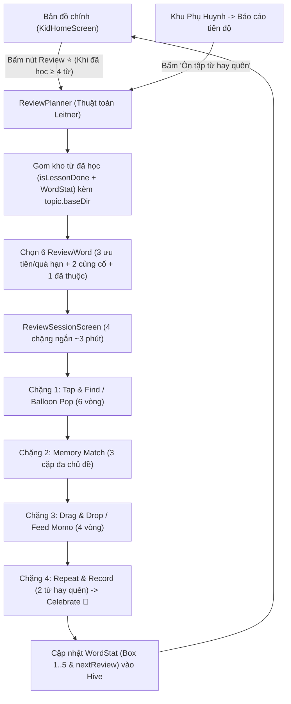

# BÁO CÁO KHẢO SÁT & Ý TƯỞNG: BÀI ÔN TẬP THÔNG MINH (SMART REVIEW)
## Ứng dụng "Bé Vui Tiếng Anh" (Độ tuổi 3.5 – 6 tuổi)

> **Ngày lập:** 25/11/2026
> **Tài liệu liên quan:**
> - [BAO_CAO_PHAN_TICH.md](file:///c:/workspace/ai_project/kids_english_app/docs/BAO_CAO_PHAN_TICH.md)
> - [KE_HOACH_TRIEN_KHAI.md](file:///c:/workspace/ai_project/kids_english_app/docs/KE_HOACH_TRIEN_KHAI.md)
> - [KE_HOACH_MO_RONG_20_CHU_DE.md](file:///c:/workspace/ai_project/kids_english_app/docs/KE_HOACH_MO_RONG_20_CHU_DE.md)

---

## 1. Khảo Sát Hiện Trạng Mã Nguồn & Dữ Liệu

### 1.1. Nền tảng kỹ thuật đã có sẵn trong App
Qua khảo sát mã nguồn hiện tại của `kids_english_app/app`, hệ thống đã có sẵn các thành phần cốt lõi để phục vụ việc ôn tập thông minh:
* **Thuật toán lặp lại ngắt quãng Leitner (`lib/data/leitner.dart`):**
  * Đã cài đặt 5 hộp ghi nhớ (`Box 1` → `Box 5`) với khoảng thời gian ôn tập tăng dần: `0 – 1 – 3 – 7 – 14 ngày` (`leitnerIntervalDays = [0, 0, 1, 3, 7, 14]`).
  * Mô hình `WordStat` theo dõi đầy đủ: `exposures` (số lần gặp), `correct` (số lần đúng), `wrong` (số lần sai), `box` (cấp độ nhớ `1..5`), `nextReview` (ngày cần ôn tiếp theo).
  * Quy ước sẵn: `mastered` (đã thuộc) khi `box >= 3`; `isDue(now)` (đến hạn ôn) khi `!nextReview.isAfter(now)`.
* **Lưu trữ tiến độ theo từng hồ sơ bé (`lib/data/storage.dart`):**
  * Lưu trạng thái hoàn thành từng bài học (`isLessonDone(profileId, lessonId)`) và tự động ghi nhận kết quả từng lần bé trả lời trong mini-game (`recordWordAttempt(profileId, wordId, correct: ...)`).
* **Hệ thống 25 chủ đề (`t01..t05` built-in + `t06..t25` gói `.bvpack` Google Drive):**
  * Tổng cộng **264 từ vựng** với đầy đủ hình ảnh PNG, nghĩa tiếng Việt (`vi`), câu ví dụ (`sentence`) và phát âm.

### 1.2. Khoảng trống hiện tại cần bổ sung
1. **Chưa có màn hình & luồng Ôn tập riêng cho bé:** Dữ liệu `WordStat` mới chỉ được ghi vào Hive nhưng chưa được tận dụng để tạo ra bài ôn tập tự động cho bé.
2. **Chưa hỗ trợ trộn từ đa chủ đề (`Cross-Topic`):** Do các chủ đề mở rộng (`t06..t25`) nằm ở thư mục gói riêng (`topic.baseDir != null`) còn `t01..t05` nằm trong `assets` (`topic.baseDir == null`), các hoạt động hiện tại đang nhận chung 1 `baseDir` cho cả màn chơi. Để ôn tập trộn nhiều chủ đề cùng lúc, cần mô hình bọc `ReviewWord(word, baseDir, topicTitle)` để mỗi thẻ từ tự tải đúng ảnh/âm thanh từ nguồn của riêng nó.
3. **Khu Phụ Huynh chưa hiển thị "Kho từ vựng của bé":** Tab `ProgressReportTab` hiện chỉ có biểu đồ phút học 7 ngày gần nhất, chưa thống kê danh sách từ bé đã học, đã thuộc (`Box 3–5`) và từ cần ôn (`Box 1–2`).

---

## 2. Khảo Sát Thực Tiễn & Nguyên Tắc Sư Phạm (Trẻ 3.5 – 6 Tuổi)

Dựa trên kinh nghiệm từ các ứng dụng giáo dục sớm hàng đầu (**Lingokids**, **Duolingo ABC**, **Khan Academy Kids**, **Monkey Junior**), việc ôn tập cho trẻ mầm non cần tuân thủ 5 nguyên tắc vàng:

| Nguyên tắc | Giải thích sư phạm | Ứng dụng vào "Bé Vui Tiếng Anh" |
|---|---|---|
| **1. Game hóa hoàn toàn** | Trẻ 4 tuổi không hiểu khái niệm "ôn bài" hay "kiểm tra"; trẻ học qua chơi | Gọi là **"Săn sao cùng Momo" / "Đảo Kho Báu Ôn Tập"** thay vì "Bài kiểm tra" |
| **2. Trộn đa chủ đề (Interleaved Practice)** | Trộn từ từ nhiều chủ đề khác nhau giúp não bộ phân biệt ngữ nghĩa thực sự thay vì nhớ vẹt theo vị trí bài | Một phiên ôn tập 6 từ có thể gồm: *Dog (Animals) + Apple (Fruits) + Blue (Colors) + Car (Vehicles)* |
| **3. Tỷ lệ Vui – Dễ – Thử thách (70 / 30)** | Nếu đưa toàn từ bé quên, bé sẽ nhanh nản và đóng app | Cài xen 2–3 từ đã nhớ/mới học cùng 2–3 từ hay sai để bé luôn có cảm giác tự tin chiến thắng |
| **4. Phiên ngắn 3–5 phút (6 từ/lượt)** | Trẻ 4 tuổi chỉ tập trung tốt trong khoảng ngắn | Mỗi phiên ôn tập gồm đúng **6 từ tối ưu nhất** theo Leitner, chơi qua 3–4 chặng nhanh (~3 phút) |
| **5. Không phạt, không "Game Over"** | Thất bại làm trẻ sợ ngoại ngữ | Chọn nhầm chỉ rung nhẹ + Momo nhắc lại + viền sáng gợi ý sau 2 lần sai |

---

## 3. Đề Xuất 4 Ý Tưởng Chế Độ Ôn Tập

### 🌟 Ý tưởng 1 (Cốt lõi – Ưu tiên số 1): "Ôn Tập Hằng Ngày Cùng Momo" (Smart Leitner Review)
* **Điểm vào trên giao diện Bé (`KidHomeScreen`):**
  * Đặt nút nổi bật **"Review ⭐"** (hoặc **Hòn đảo Kho Báu Ôn Tập** ở đầu bản đồ) ngay trên Bản đồ chính.
  * Tự động mở khóa khi bé đã học từ **4 từ trở lên**.
  * Hiện huy hiệu nhỏ (badge số hoặc ngôi sao nhấp nháy) khi có từ đến hạn ôn (`isDue(now) == true`).
* **Thuật toán chọn 6 từ thông minh (`ReviewPlanner`):**
  * *Nguồn từ đã học:* Hợp nhất toàn bộ từ thuộc các bài học đã hoàn thành (`isLessonDone == true`) + các từ đã có bản ghi `WordStat` (`exposures > 0`).
  * *Phân bổ 6 từ trong 1 phiên:*
    1. **3 từ ưu tiên cao nhất:** Các từ đang ở `Box 1` (bé hay chọn nhầm) hoặc đã quá hạn `nextReview <= today` lâu nhất.
    2. **2 từ củng cố:** Các từ ở `Box 2` (mới học gần đây, cần nhắc lại sau 1 ngày để đưa vào trí nhớ dài hạn).
    3. **1 từ đã thuộc (`Box ≥ 3`):** Từ cũ đã lâu chưa gặp, giúp bé tự tin và duy trì trí nhớ dài hạn.
    *(Nếu nhóm nào chưa đủ số lượng, tự động bù từ các nhóm còn lại trong kho từ đã học).*
* **Chuỗi hoạt động 4 bước siêu gọn (~3 phút):**
  1. **Nghe & Tìm nhanh (`Tap & Find` đa chủ đề):** 6 vòng, độ khó thích ứng 2 → 4 lựa chọn, dùng kho từ đã học làm đáp án nhiễu.
  2. **Lật thẻ trí nhớ (`Memory Match`):** 3 cặp (6 thẻ) lấy từ 6 từ của phiên ôn tập.
  3. **Hộp thần kỳ (`Drag & Drop`):** 4 vòng kéo thả những từ ưu tiên ôn nhất vào hộp.
  4. **Nói cùng Momo (`Repeat & Record`):** 2 từ bé hay sai nhất để bé nhắc lại và nghe lại giọng mình $\rightarrow$ **Tung pháo giấy + Nhận Sao Vàng + Tự động thăng hạng Box Leitner!**

---

### 🎈 Ý tưởng 2 (Mini-game mới cực cuốn trẻ 4 tuổi): "Đập Bóng Bay Từ Vựng" (Balloon / Bubble Pop)
* **Cơ chế chơi:**
  * Màn hình bầu trời pastel dịu mắt; các quả bóng bay (hoặc bong bóng xà phòng) mang hình ảnh những từ bé đã học bay chậm rãi từ dưới lên trên (tốc độ vừa phải phù hợp vận động tinh trẻ 4 tuổi).
  * Momo gọi to: *"Pop the... Elephant!"* (kèm hình bóng mờ hoặc chỉ âm thanh tùy độ khó).
  * Bé chạm vỡ đúng quả bóng có hình Con voi $\rightarrow$ hiệu ứng nổ bóng lách tách + sao bay ra + phát âm khen ngợi!
  * Nếu chạm nhầm quả bóng khác: bóng chỉ nảy nhẹ và đọc tên từ của quả bóng đó (*"Oh, that's a Cat! Find the Elephant!"*) — biến cả lần chạm nhầm thành một lần học tự nhiên!
* **Giá trị:** Luyện phản xạ nghe – nhận diện cực nhanh, tạo sự mới mẻ so với các game có sẵn trong bài học chính.

---

### 🎁 Ý tưởng 3 (Tương tác cùng Mascot): "Cho Momo Ăn / Tặng Quà Momo" (Feed / Give Momo)
* **Cơ chế chơi:**
  * Chú khỉ Momo đứng giữa màn hình với bong bóng suy nghĩ, nói: *"I want an apple!"* hoặc *"Give me the fire truck!"*.
  * Bên dưới có 3–4 đồ vật từ kho từ vựng bé đã học.
  * Bé kéo thả đúng đồ vật đưa vào tay/miệng Momo $\rightarrow$ Momo nhảy múa vui sướng (`momo_cheer`), ăn/ôm món đồ đó và nói *"Yummy! Thank you!"* / *"Awesome! A fire truck!"*.
* **Khả năng mở rộng tương lai:** Khi bé đã học qua nhiều chủ đề (Level 2–5), có thể nâng cấp thành **ôn tập ghép 2 từ (Tính từ + Danh từ)** như *"Give me the RED apple!"*, *"Find the BIG elephant!"*.

---

### 📊 Ý tưởng 4 (Hỗ trợ Phụ huynh đồng hành): "Kho Từ Vựng Của Bé" (My Word Bank)
* **Vị trí:** Nâng cấp trực tiếp trong tab **Báo cáo tiến độ (`ProgressReportTab`)** ở Khu Phụ Huynh.
* **Nội dung hiển thị:**
  * **3 thẻ thống kê tổng quan:** Tổng số từ đã học | 🟢 Đã thuộc (`Box 3–5`) | 🔴 Cần ôn tập (`Box 1–2` / đến hạn).
  * **Danh sách từ phân nhóm theo trạng thái ghi nhớ:** Mỗi thẻ từ hiển thị hình nhỏ + chữ tiếng Anh + nghĩa tiếng Việt + số sao Box Leitner (`1..5`); bố mẹ bấm vào từng từ có thể nghe phát âm chuẩn.
  * **Nút hành động nhanh:** *"Bắt đầu ôn tập những từ bé hay quên"* — cho phép bố mẹ chủ động khởi chạy ngay một phiên ôn tập tập trung vào nhóm từ màu đỏ (`Box 1`).

---

## 4. Kiến Trúc Kỹ Thuật & Luồng Hoạt Động Đề Xuất

### Lưu ý kỹ thuật quan trọng
* **Hỗ trợ đa nguồn `baseDir` (`ReviewWord`):**
  * Tạo lớp `ReviewWord { final Word word; final String? baseDir; final String topicId; }` để khi trộn từ từ `t01..t05` (built-in) và `t06..t25` (`.bvpack` Google Drive) trong cùng một màn chơi, mỗi hình ảnh (`MediaImage`) và file âm thanh (`AudioService.playWord`) đều trỏ đúng `baseDir` của từ đó.
* **Tự động khởi tạo `WordStat` khi hoàn thành bài học:**
  * Đảm bảo khi bé hoàn thành bất kỳ bài học nào (`_completeLesson`), các từ mới trong `lesson.newWords` nếu chưa có `WordStat` sẽ được khởi tạo ở `Box 1` để lập tức xuất hiện trong kho từ ôn tập của bé.

---

## 5. Lộ Trình Triển Khai Đề Xuất

| Giai đoạn | Hạng mục triển khai | Mục tiêu |
|---|---|---|
| **Giai đoạn 1 (Cốt lõi – Ưu tiên)** | • `ReviewWord` + `ReviewPlanner` (thuật toán Leitner chọn 6 từ đa chủ đề) • Nút **Review ⭐** trên `KidHomeScreen` (hiện số từ đến hạn ôn) • Màn hình `ReviewSessionScreen` tái sử dụng & nâng cấp `TapFind`, `MemoryMatch`, `DragDrop`, `RepeatRecord`, `Celebrate` hỗ trợ đa `baseDir` • Nâng cấp `ProgressReportTab` với **Kho từ vựng của bé** (3 nhóm Đã thuộc / Đang nhớ / Cần ôn) | Bé có ngay chế độ ôn tập thông minh chạy mượt cho cả 25 chủ đề; phụ huynh theo dõi được chính xác từng từ bé nhớ/quên |
| **Giai đoạn 2 (Game hóa nâng cao)** | • Xây dựng mini-game mới **Đập Bóng Bay Từ Vựng (`BalloonPopActivity`)** • Xây dựng mini-game tương tác **Cho Momo Ăn / Tặng Quà (`FeedMomoActivity`)** • Xoay vòng ngẫu nhiên các mini-game trong mỗi lần bé bấm Ôn tập để luôn mới mẻ | Tăng độ hào hứng lâu dài, giúp bé tự giác bấm ôn tập mỗi ngày như một trò chơi yêu thích |
