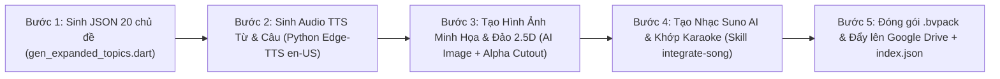

# KHẢO SÁT, PHÂN TÍCH & KẾ HOẠCH TRIỂN KHAI MỞ RỘNG 20 CHỦ ĐỀ MỚI
## Ứng dụng "Bé Vui Tiếng Anh" (Lộ trình Toàn diện 25 Chủ đề: `t01` → `t25`)

> **Tài liệu liên quan:**
> - [BAO_CAO_PHAN_TICH.md](file:///c:/workspace/ai_project/kids_english_app/docs/BAO_CAO_PHAN_TICH.md)
> - [KE_HOACH_TRIEN_KHAI.md](file:///c:/workspace/ai_project/kids_english_app/docs/KE_HOACH_TRIEN_KHAI.md)
> - [ASSET_SPEC.md](file:///c:/workspace/ai_project/kids_english_app/docs/ASSET_SPEC.md)
> - [KE_HOACH_NAP_CHU_DE_GOOGLE_DRIVE.md](file:///c:/workspace/ai_project/kids_english_app/docs/KE_HOACH_NAP_CHU_DE_GOOGLE_DRIVE.md)

---

## 1. Khảo Sát & Phân Tích Sư Phạm

### 1.1. Đánh giá 5 chủ đề nền tảng hiện có (Level 1 – MVP)
Hiện tại ứng dụng đã hoàn thiện **5 chủ đề cốt lõi** (`52 từ vựng`, `20 bài học`, `5 bài hát Karaoke`):
1. **`t01_hello` (Hello! – Chào hỏi & Gia đình cơ bản):** `hello, goodbye, boy, girl, mommy, daddy, baby, friend` (8 từ).
2. **`t02_colors` (Colors – Màu sắc cơ bản):** `red, blue, yellow, green, orange, pink, purple, black, white, brown` (10 từ).
3. **`t03_numbers` (Numbers 1–10 – Số đếm):** `one, two, three, four, five, six, seven, eight, nine, ten` (10 từ).
4. **`t04_animals` (Animals – Thú cưng & Vật nuôi nông trại):** `dog, cat, bird, fish, duck, chicken, cow, pig, horse, rabbit, mouse, sheep` (12 từ).
5. **`t05_body` (My Body – Cơ thể bé):** `head, eyes, ears, nose, mouth, hair, hands, fingers, arms, legs, feet, tummy` (12 từ).

### 1.2. Cơ sở khảo sát để lựa chọn 20 chủ đề mới
Dựa trên khảo sát khung chương trình **Cambridge Pre-A1 Starters**, **Oxford Show and Tell (Kindergarten)**, **Lingokids**, và tâm lý phát triển ngôn ngữ của trẻ em Việt Nam độ tuổi **3.5 – 6 tuổi**, việc mở rộng thêm **20 chủ đề mới (`t06` → `t25`)** cần tuân thủ **Mô hình Chương trình Xoắn ốc (Spiral Curriculum)**:

1. **Mở rộng trực tiếp từ 5 chủ đề đã học (5 chủ đề):** Trẻ 4 tuổi rất hào hứng khi gặp lại chủ đề quen thuộc ở cấp độ phong phú hơn:
   - Mở rộng `t01_hello` $\rightarrow$ **Đại gia đình & Người thân (`t06_family`)**.
   - Mở rộng `t04_animals` $\rightarrow$ **Động vật hoang dã / Sở thú (`t07_wild_animals`)** và **Sinh vật biển & Côn trùng (`t08_sea_bugs`)**.
   - Mở rộng `t02_colors` $\rightarrow$ **Hình khối & Sắc màu kết hợp (`t09_shapes`)**.
   - Mở rộng `t03_numbers` $\rightarrow$ **Số đếm 11–20 & Kích thước so sánh (`t10_numbers_sizes`)**.
2. **Mở rộng sang Môi trường sống trực tiếp quanh bé mỗi ngày (5 chủ đề):**
   - Những thứ bé ăn, uống, mặc, chơi và nhìn thấy trong nhà: **Trái cây (`t11_fruits`)**, **Đồ ăn & Thức uống (`t12_food_drinks`)**, **Đồ chơi (`t13_toys`)**, **Quần áo (`t14_clothes`)**, **Ngôi nhà (`t15_my_house`)**.
3. **Mở rộng sang Cảm xúc, Vận động & Thói quen tự lập (5 chủ đề):**
   - Kết nối với `t05_body` để bé biết diễn đạt trạng thái bản thân: **Cảm xúc (`t16_feelings`)**, **Động từ vận động (`t17_actions`)**, **Sinh hoạt hằng ngày (`t18_routines`)**, **Đồ dùng bàn ăn (`t19_tableware`)**, **Từ trái nghĩa (`t20_opposites`)**.
4. **Mở rộng ra Thế giới xã hội & Thiên nhiên bên ngoài (5 chủ đề):**
   - Khi bé đi dạo, đi học mẫu giáo và tham gia lễ hội: **Phương tiện giao thông (`t21_vehicles`)**, **Thời tiết & Thiên nhiên (`t22_weather_nature`)**, **Trường mầm non (`t23_school`)**, **Nghề nghiệp (`t24_jobs`)**, **Tiệc sinh nhật & Lễ hội (`t25_party_holidays`)**.

---

## 2. Bảng Tổng Quan 20 Chủ Đề Mới (`t06` → `t25`)

| STT | Mã Chủ Đề (`id`) | Cấp độ | Tên Tiếng Anh | Tên Tiếng Việt | Số từ | Liên kết / Mở rộng từ |
|---|---|---|---|---|---|---|
| 01 | `t06_family` | Level 2 | **My Big Family** | Đại gia đình yêu thương | 10 | Mở rộng từ `t01_hello` |
| 02 | `t07_wild_animals` | Level 2 | **Zoo Animals** | Động vật sở thú | 12 | Mở rộng từ `t04_animals` |
| 03 | `t08_sea_bugs` | Level 2 | **Ocean & Bugs** | Sinh vật biển & Côn trùng | 10 | Mở rộng từ `t04_animals` |
| 04 | `t09_shapes` | Level 2 | **Fun Shapes** | Hình khối quanh bé | 10 | Mở rộng từ `t02_colors` |
| 05 | `t10_numbers_sizes` | Level 2 | **Numbers & Sizes** | Số đếm & Kích thước | 10 | Mở rộng từ `t03_numbers` |
| 06 | `t11_fruits` | Level 3 | **Yummy Fruits** | Trái cây tươi ngon | 10 | Chủ đề mới (Đời sống) |
| 07 | `t12_food_drinks` | Level 3 | **Food & Drinks** | Đồ ăn & Thức uống | 12 | Chủ đề mới (Đời sống) |
| 08 | `t13_toys` | Level 3 | **My Toys** | Đồ chơi của bé | 10 | Chủ đề mới (Đời sống) |
| 09 | `t14_clothes` | Level 3 | **My Clothes** | Quần áo & Trang phục | 10 | Chủ đề mới (Đời sống) |
| 10 | `t15_my_house` | Level 3 | **My Cozy House** | Ngôi nhà thân yêu | 12 | Chủ đề mới (Đời sống) |
| 11 | `t16_feelings` | Level 4 | **My Feelings** | Cảm xúc của bé | 10 | Mở rộng từ `t05_body` |
| 12 | `t17_actions` | Level 4 | **Let's Move!** | Hành động & Vận động | 12 | Mở rộng từ `t05_body` (TPR) |
| 13 | `t18_routines` | Level 4 | **Daily Routines** | Thói quen hằng ngày | 10 | Mở rộng từ `t05_body` |
| 14 | `t19_tableware` | Level 4 | **Mealtime Tools** | Đồ dùng bàn ăn | 10 | Kết nối `t12_food_drinks` |
| 15 | `t20_opposites` | Level 4 | **Fun Opposites** | Cặp từ trái nghĩa | 10 | Kết nối `t09` & `t10` |
| 16 | `t21_vehicles` | Level 5 | **Beep! Vehicles** | Phương tiện giao thông | 12 | Chủ đề mới (Khám phá) |
| 17 | `t22_weather_nature` | Level 5 | **Weather & Nature** | Thời tiết & Thiên nhiên | 12 | Chủ đề mới (Khám phá) |
| 18 | `t23_school` | Level 5 | **My Preschool** | Trường học của bé | 10 | Chủ đề mới (Khám phá) |
| 19 | `t24_jobs` | Level 5 | **Cool Jobs** | Nghề nghiệp quanh bé | 10 | Chủ đề mới (Khám phá) |
| 20 | `t25_party_holidays` | Level 5 | **Party & Holidays** | Sinh nhật & Lễ hội | 10 | Chủ đề tổng kết |

> **Tổng quy mô mở rộng:** **20 chủ đề mới** = **212 từ vựng mới** + **80 bài học** + **60 mẫu câu giao tiếp phụ huynh** + **20 bài hát thiếu nhi** + **80 sticker thưởng**.
> **Tổng toàn bộ ứng dụng (25 chủ đề):** **264 từ vựng cốt lõi** + **100 bài học** + **25 bài hát**.

---

## 3. Đặc Tả Chi Tiết Nội Dung 20 Chủ Đề Mới

### NHÓM 1: MỞ RỘNG TỪ 5 CHỦ ĐỀ GỐC (LEVEL 2 – `t06` → `t10`)

#### Chủ đề 6: `t06_family` – My Big Family (Đại gia đình yêu thương)
* **Mở rộng từ:** `t01_hello` (đã có `mommy, daddy, baby`).
* **Từ vựng (10 từ):**
  1. `family` (Gia đình) – *"I love my big family!"*
  2. `grandma` (Bà) – *"My grandma makes yummy cookies!"*
  3. `grandpa` (Ông) – *"My grandpa tells funny stories!"*
  4. `brother` (Anh / Em trai) – *"I play ball with my brother!"*
  5. `sister` (Chị / Em gái) – *"My sister sings with me!"*
  6. `uncle` (Chú / Bác / Cậu) – *"My uncle is tall and kind!"*
  7. `aunt` (Cô / Dì / Bác gái) – *"My aunt gives me a warm hug!"*
  8. `cousin` (Anh chị em họ) – *"My cousin is my good friend!"*
  9. `home` (Tổ ấm / Nhà) – *"Welcome to my happy home!"*
  10. `love` (Yêu thương) – *"I love you so much!"*
* **Mẫu câu Học cùng con (`sentences`):**
  * *"Who is this? This is my grandma."* (Ai đây nhỉ? Đây là bà của con. – *Hu i-zơ đít? Đít i-zơ mai gờ-ren-ma.*)
  * *"I love my family very much!"* (Con yêu gia đình mình nhiều lắm! – *Ai lấp mai pha-mi-li ve-ri mắt-chờ!*)
  * *"Give Grandma a big hug!"* (Ôm bà một cái thật chặt nào! – *Gíp Gờ-ren-ma ờ bíc hấc!*)
* **Bài hát chủ đề (`s06_family_song`):** *"Momo's Happy Family Tree"*
* **Hình đảo (`island_t06_family.png`):** Đảo hình cây cổ thụ ấm áp có ngôi nhà gỗ và khung ảnh trái tim gia đình.

---

#### Chủ đề 7: `t07_wild_animals` – Zoo Animals (Động vật sở thú)
* **Mở rộng từ:** `t04_animals` (từ thú nuôi nông trại mở rộng ra thế giới động vật hoang dã).
* **Từ vựng (12 từ):**
  1. `lion` (Sư tử) – *"The lion is the king! Roar!"*
  2. `tiger` (Con hổ) – *"The tiger has orange and black stripes!"*
  3. `elephant` (Con voi) – *"The elephant has a long nose!"*
  4. `monkey` (Con khỉ) – *"Momo is a happy little monkey!"*
  5. `bear` (Con gấu) – *"The big brown bear loves honey!"*
  6. `giraffe` (Hươu cao cổ) – *"The giraffe has a very long neck!"*
  7. `zebra` (Ngựa vằn) – *"The zebra is black and white!"*
  8. `hippo` (Hà mã) – *"The hippo has a big wide mouth!"*
  9. `crocodile` (Cá sấu) – *"Snap, snap goes the green crocodile!"*
  10. `snake` (Con rắn) – *"Hiss, hiss goes the long snake!"*
  11. `panda` (Gấu trúc) – *"The cute panda eats green bamboo!"*
  12. `kangaroo` (Chuột túi) – *"Jump, jump like a kangaroo!"*
* **Mẫu câu Học cùng con (`sentences`):**
  * *"Let's go to the zoo!"* (Mình cùng đi sở thú nào! – *Lét-xơ gâu tu đờ du!*)
  * *"Look at the big elephant!"* (Nhìn chú voi to chưa kìa! – *Lúc ét đờ bíc e-li-phần!*)
  * *"Can you jump like a monkey?"* (Con nhảy như chú khỉ được không? – *Ken diu chăm-pờ lai-kơ ờ măng-ki?*)
* **Bài hát chủ đề (`s07_zoo_song`):** *"Welcome to Momo's Jungle Zoo"*
* **Hình đảo (`island_t07_wild_animals.png`):** Đảo rừng nhiệt đới sở thú với cổng vòm lá xanh, hươu cao cổ và thác nước nhỏ.

---

#### Chủ đề 8: `t08_sea_bugs` – Ocean & Bugs (Sinh vật biển & Côn trùng nhỏ)
* **Mở rộng từ:** `t04_animals` (mở rộng từ `fish` ra đại dương và khu vườn).
* **Từ vựng (10 từ):**
  1. `shark` (Cá mập) – *"The baby shark swims fast in the sea!"*
  2. `whale` (Cá voi) – *"The blue whale is super big!"*
  3. `dolphin` (Cá heo) – *"The clever dolphin jumps over the waves!"*
  4. `turtle` (Con rùa) – *"The sea turtle swims nice and slow!"*
  5. `crab` (Con cua) – *"The red crab walks sideways! Click, click!"*
  6. `octopus` (Bạch tuộc) – *"The octopus has eight funny arms!"*
  7. `starfish` (Sao biển) – *"Look at the pretty star under the sea!"*
  8. `bee` (Con ong) – *"Buzz, buzz goes the yellow bee!"*
  9. `butterfly` (Con bướm) – *"The colorful butterfly flies over the flowers!"*
  10. `ladybug` (Bọ rùa) – *"The little red ladybug has black spots!"*
* **Mẫu câu Học cùng con (`sentences`):**
  * *"What lives in the ocean?"* (Con gì sống ở dưới biển nhỉ? – *Quát líp-xơ in đờ âu-sần?*)
  * *"Look! A pretty butterfly!"* (Nhìn kìa! Một chú bướm xinh đẹp! – *Lúc! Ờ pờ-rít-ti bắt-tơ-phờ-lai!*)
* **Bài hát chủ đề (`s08_ocean_song`):** *"Deep Down in the Sparkly Sea"*
* **Hình đảo (`island_t08_sea_bugs.png`):** Đảo san hô rực rỡ với rùa biển, sao biển và hoa cỏ có bướm bay phía trên.

---

#### Chủ đề 9: `t09_shapes` – Fun Shapes (Hình khối quanh bé)
* **Mở rộng từ:** `t02_colors` (ghép màu sắc đã học với hình khối: *a red circle, a yellow star*).
* **Từ vựng (10 từ):**
  1. `circle` (Hình tròn) – *"A round circle, like a ball!"*
  2. `square` (Hình vuông) – *"A square has four equal sides!"*
  3. `triangle` (Hình tam giác) – *"A triangle has three corners!"*
  4. `star` (Hình ngôi sao) – *"A bright yellow star in the sky!"*
  5. `heart` (Hình trái tim) – *"A pink heart full of love!"*
  6. `rectangle` (Hình chữ nhật) – *"The door is a big rectangle!"*
  7. `oval` (Hình bầu dục) – *"An egg has an oval shape!"*
  8. `diamond` (Hình thoi / Kim cương) – *"The kite is a flying diamond!"*
  9. `rainbow` (Cầu vồng) – *"Look at the seven-color rainbow!"*
  10. `line` (Đường thẳng) – *"Draw a straight line with me!"*
* **Mẫu câu Học cùng con (`sentences`):**
  * *"What shape is it? It's a circle!"* (Hình gì đây con? Hình tròn đấy! – *Quát sếp i-zơ ít? Ít-xơ ờ xơ-cồ!*)
  * *"Can you find something round?"* (Con tìm xem đồ vật nào hình tròn nhé? – *Ken diu phai xăm-thinh rao?*)
* **Bài hát chủ đề (`s09_shapes_song`):** *"Shapes All Around Us"*
* **Hình đảo (`island_t09_shapes.png`):** Đảo lắp ghép từ các khối hình học 3D đầy màu sắc (tròn, vuông, tam giác, ngôi sao).

---

#### Chủ đề 10: `t10_numbers_sizes` – Numbers & Sizes (Số đếm 11–20 & Kích thước)
* **Mở rộng từ:** `t03_numbers` (nâng từ 1–10 lên các mốc số lớn hơn và khái niệm toán học cơ bản cho trẻ mầm non).
* **Từ vựng (10 từ):**
  1. `eleven` (Số 11) – *"Eleven! Eleven shiny stars!"*
  2. `twelve` (Số 12) – *"Twelve! Twelve yummy cookies!"*
  3. `fifteen` (Số 15) – *"Fifteen! Let's count to fifteen!"*
  4. `twenty` (Số 20) – *"Twenty! Ten fingers and ten toes make twenty!"*
  5. `big` (To / Lớn) – *"The elephant is very big!"*
  6. `small` (Nhỏ / Bé) – *"The little mouse is so small!"*
  7. `tall` (Cao) – *"The giraffe is super tall!"*
  8. `short` (Thấp / Ngắn) – *"The little puppy is short!"*
  9. `long` (Dài) – *"The train is very long!"*
  10. `heavy` (Nặng) – *"This big box is heavy!"*
* **Mẫu câu Học cùng con (`sentences`):**
  * *"Is it big or small?"* (Nó to hay nhỏ nhỉ? – *I-zơ ít bíc o xờ-mô?*)
  * *"It's big! / It's small!"* (Nó to lắm! / Nó nhỏ xíu! – *Ít-xơ bíc! / Ít-xơ xờ-mô!*)
* **Bài hát chủ đề (`s10_sizes_song`):** *"Big and Small, Count Them All"*
* **Hình đảo (`island_t10_numbers_sizes.png`):** Đảo cân thăng bằng vui nhộn với các con số lớn và chú voi to bên cạnh chú chuột nhỏ.

---

### NHÓM 2: THẾ GIỚI QUANH BÉ HẰNG NGÀY (LEVEL 3 – `t11` → `t15`)

#### Chủ đề 11: `t11_fruits` – Yummy Fruits (Trái cây tươi ngon)
* **Từ vựng (10 từ):**
  1. `apple` (Quả táo) – *"Crunch! A sweet red apple!"*
  2. `banana` (Quả chuối) – *"Momo loves yellow bananas!"*
  3. `orange` (Quả cam) – *"A juicy round orange!"*
  4. `mango` (Quả xoài) – *"Sweet yellow mango, yummy!"*
  5. `watermelon` (Dưa hấu) – *"Big green watermelon, red inside!"*
  6. `grapes` (Chùm nho) – *"Purple grapes, one by one!"*
  7. `strawberry` (Quả dâu tây) – *"A cute little red strawberry!"*
  8. `pineapple` (Quả dứa / Thơm) – *"A pineapple wears a green crown!"*
  9. `peach` (Quả đào) – *"A soft pink peach!"*
  10. `coconut` (Quả dừa) – *"Cool coconut water on a sunny day!"*
* **Mẫu câu Học cùng con (`sentences`):**
  * *"Do you like apples? Yes, I do!"* (Con có thích táo không? Dạ có ạ! – *Đu diu lai áp-pồ-xơ? Diét, ai đu!*)
  * *"Eat your fruit! It's yummy!"* (Ăn hoa quả nào con! Ngon lắm đấy! – *Ít gio phờ-rút! Ít-xơ dăm-mi!*)
* **Bài hát chủ đề (`s11_fruits_song`):** *"Yummy Fruit Salad Dance"*
* **Hình đảo (`island_t11_fruits.png`):** Đảo vườn cây ăn quả với cây táo đỏ, dưa hấu khổng lồ và chùm chuối vàng.

---

#### Chủ đề 12: `t12_food_drinks` – Food & Drinks (Đồ ăn & Thức uống)
* **Từ vựng (12 từ):**
  1. `rice` (Cơm) – *"White rice in my little bowl!"*
  2. `bread` (Bánh mì) – *"Warm bread for breakfast!"*
  3. `egg` (Quả trứng) – *"One yummy egg for you!"*
  4. `soup` (Súp / Canh) – *"Blow on the warm soup!"*
  5. `noodles` (Mì / Phở) – *"Slurp, slurp! Yummy noodles!"*
  6. `pizza` (Bánh pizza) – *"Let's share a slice of pizza!"*
  7. `cake` (Bánh ngọt) – *"A sweet strawberry cake!"*
  8. `ice_cream` (Kem) – *"Cold and sweet ice cream!"*
  9. `milk` (Sữa) – *"Drink your milk to grow tall!"*
  10. `water` (Nước lọc) – *"Drink clean water every day!"*
  11. `juice` (Nước ép trái cây) – *"Fresh orange juice, please!"*
  12. `cookie` (Bánh quy) – *"Crunchy chocolate chip cookie!"*
* **Mẫu câu Học cùng con (`sentences`):**
  * *"I'm hungry! / I'm thirsty!"* (Con đói bụng! / Con khát nước! – *Ai-mơ hăng-gờ-ri! / Ai-mơ thơ-xờ-ti!*)
  * *"Can I have some milk, please?"* (Cho con xin một ít sữa ạ! – *Ken ai hép xăm miu-kờ, pờ-li-zơ?*)
  * *"Here you are! – Thank you!"* (Của con đây! – Con cảm ơn ạ! – *Hia diu a! – Thanh kiu!*)
* **Bài hát chủ đề (`s12_food_song`):** *"Hungry Tummy, Yummy Food"*
* **Hình đảo (`island_t12_food_drinks.png`):** Đảo bàn tiệc dã ngoại với hộp sữa, bánh mì, tô cơm và ly nước cam tươi.

---

#### Chủ đề 13: `t13_toys` – My Toys (Đồ chơi của bé)
* **Từ vựng (10 từ):**
  1. `ball` (Quả bóng) – *"Bounce, bounce the colorful ball!"*
  2. `doll` (Búp bê) – *"A cute little doll in a pink dress!"*
  3. `teddy_bear` (Gấu bông) – *"Hug my soft brown teddy bear!"*
  4. `toy_car` (Xe đồ chơi) – *"Zoom, zoom goes the red toy car!"*
  5. `blocks` (Khối xếp hình) – *"Build a tall tower with blocks!"*
  6. `kite` (Cánh diều) – *"Fly the kite high in the sky!"*
  7. `robot` (Người máy) – *"Beep, boop! Walk like a robot!"*
  8. `balloon` (Bóng bay) – *"Hold the shiny floating balloon!"*
  9. `puzzle` (Tranh ghép hình) – *"Put the puzzle pieces together!"*
  10. `drum` (Cái trống) – *"Boom, boom, play the little drum!"*
* **Mẫu câu Học cùng con (`sentences`):**
  * *"Let's play with the ball!"* (Mình cùng chơi bóng nhé! – *Lét-xơ pờ-lây quít đờ bô!*)
  * *"Let's share our toys!"* (Mình cùng chia sẻ đồ chơi nhé! – *Lét-xơ se ao-ờ toi-zơ!*)
  * *"Clean up your toys, please!"* (Cất dọn đồ chơi gọn gàng nào con! – *Cờ-lin ắp gio toi-zơ, pờ-li-zơ!*)
* **Bài hát chủ đề (`s13_toys_song`):** *"The Magic Toy Box"*
* **Hình đảo (`island_t13_toys.png`):** Đảo thùng đồ chơi diệu kỳ mở nắp với gấu bông, bóng, khối gỗ và diều bay.

---

#### Chủ đề 14: `t14_clothes` – My Clothes (Quần áo & Trang phục)
* **Từ vựng (10 từ):**
  1. `shirt` (Áo sơ mi) – *"Button up your clean shirt!"*
  2. `t_shirt` (Áo thun) – *"Momo wears a blue T-shirt!"*
  3. `pants` (Quần dài) – *"Put on your comfy pants!"*
  4. `shorts` (Quần đùi) – *"Cool shorts for a sunny day!"*
  5. `dress` (Váy liền) – *"A pretty yellow dress!"*
  6. `skirt` (Chân váy) – *"Spin around in a cute skirt!"*
  7. `shoes` (Đôi giày) – *"Put on your shoes to go outside!"*
  8. `socks` (Đôi tất / Vớ) – *"Two warm socks for my two feet!"*
  9. `hat` (Cái mũ / Nón) – *"Wear a sun hat on your head!"*
  10. `jacket` (Áo khoác) – *"Zip up your warm jacket!"*
* **Mẫu câu Học cùng con (`sentences`):**
  * *"Put on your shoes, please!"* (Con đi giày vào nhé! – *Pút on gio su-zơ, pờ-li-zơ!*)
  * *"Take off your hat!"* (Cởi mũ ra nào con! – *Tếch óp gio hét!*)
* **Bài hát chủ đề (`s14_clothes_song`):** *"Get Dressed with Momo"*
* **Hình đảo (`island_t14_clothes.png`):** Đảo tủ đồ sắc màu với dây phơi quần áo nhỏ xinh, mũ, giày và áo thun ngôi sao.

---

#### Chủ đề 15: `t15_my_house` – My Cozy House (Ngôi nhà thân yêu)
* **Từ vựng (12 từ):**
  1. `house` (Ngôi nhà) – *"This is my cozy little house!"*
  2. `door` (Cánh cửa) – *"Knock, knock! Open the door!"*
  3. `window` (Cửa sổ) – *"Look out the sunny window!"*
  4. `bedroom` (Phòng ngủ) – *"I sleep in my quiet bedroom!"*
  5. `kitchen` (Phòng bếp) – *"Daddy cooks in the kitchen!"*
  6. `bathroom` (Phòng tắm) – *"Wash hands in the bathroom!"*
  7. `bed` (Cái giường) – *"A soft pillow on my bed!"*
  8. `table` (Cái bàn) – *"Put the book on the table!"*
  9. `chair` (Cái ghế) – *"Sit down nicely on the chair!"*
  10. `sofa` (Ghế sô-pha) – *"We read stories on the sofa!"*
  11. `lamp` (Đèn bàn) – *"Turn on the bright little lamp!"*
  12. `clock` (Đồng hồ) – *"Tick-tock goes the wall clock!"*
* **Mẫu câu Học cùng con (`sentences`):**
  * *"Open the door / Close the door, please."* (Mở cửa / Đóng cửa giúp mẹ nhé. – *Âu-pần đờ đo / Cờ-lâu-zơ đờ đo, pờ-li-zơ.*)
  * *"Where is the cat? Under the table!"* (Con mèo đâu rồi? Ở dưới gầm bàn kìa! – *Que i-zơ đờ két? Ăn-đờ đờ tây-bồ!*)
* **Bài hát chủ đề (`s15_house_song`):** *"Welcome to My Cozy House"*
* **Hình đảo (`island_t15_my_house.png`):** Đảo ngôi nhà mái đỏ xinh xắn có cửa sổ sáng đèn, vườn hoa nhỏ và ống khói.

---

### NHÓM 3: CẢM XÚC, VẬN ĐỘNG & SINH HOẠT (LEVEL 4 – `t16` → `t20`)

#### Chủ đề 16: `t16_feelings` – My Feelings (Cảm xúc của bé)
* **Mở rộng từ:** `t05_body` & `t01_hello` (giúp bé gọi tên cảm xúc của chính mình).
* **Từ vựng (10 từ):**
  1. `happy` (Vui vẻ) – *"I am happy! Smile big!"*
  2. `sad` (Buồn) – *"When I feel sad, I need a hug."*
  3. `angry` (Tức giận) – *"Take a deep breath when you're angry."*
  4. `scared` (Sợ hãi) – *"Don't be scared, Mommy is here!"*
  5. `sleepy` (Buồn ngủ) – *"Yawn! I am so sleepy now!"*
  6. `tired` (Mệt) – *"Let's sit and rest when we're tired."*
  7. `hungry` (Đói bụng) – *"My tummy says I'm hungry!"*
  8. `thirsty` (Khát nước) – *"I'm thirsty, I want some water!"*
  9. `surprised` (Ngạc nhiên) – *"Wow! What a big surprise!"*
  10. `excited` (Hào hứng) – *"Hooray! I am super excited!"*
* **Mẫu câu Học cùng con (`sentences`):**
  * *"How do you feel today? I'm happy!"* (Hôm nay con cảm thấy thế nào? Con rất vui! – *Hao đu diu phiu tu-đây? Ai-mơ hép-pi!*)
  * *"Are you sleepy? Let's go to bed."* (Con buồn ngủ chưa? Mình đi ngủ nhé. – *A diu xờ-li-pi? Lét-xơ gâu tu bét.*)
* **Bài hát chủ đề (`s16_feelings_song`):** *"Happy Faces, Many Feelings"*
* **Hình đảo (`island_t16_feelings.png`):** Đảo cầu vồng cảm xúc với những đám mây mặt cười vui vẻ, ngạc nhiên và ấm áp.

---

#### Chủ đề 17: `t17_actions` – Let's Move! (Hành động & Vận động TPR)
* **Mở rộng từ:** `t05_body` (biến cơ thể thành chuyển động thực tế).
* **Từ vựng (12 từ):**
  1. `run` (Chạy) – *"Run, run fast in the park!"*
  2. `jump` (Nhảy bật lên) – *"Jump up high into the air!"*
  3. `walk` (Đi bộ) – *"Walk, walk, one step at a time!"*
  4. `dance` (Nhảy múa) – *"Dance to the happy music!"*
  5. `sing` (Ca hát) – *"La-la-la! Sing a joyful song!"*
  6. `swim` (Bơi) – *"Swim like a little fish!"*
  7. `fly` (Bay) – *"Spread your arms and fly like a bird!"*
  8. `climb` (Leo trèo) – *"Momo likes to climb the tree!"*
  9. `sit` (Ngồi xuống) – *"Sit down gently on the mat!"*
  10. `stand` (Đứng lên) – *"Stand up tall and straight!"*
  11. `laugh` (Cười vang) – *"Ha-ha-ha! Laugh out loud!"*
  12. `hug` (Ôm) – *"Give your friend a warm hug!"*
* **Mẫu câu Học cùng con (`sentences`):**
  * *"Can you jump? Yes, I can!"* (Con nhảy lên được không? Con làm được! – *Ken diu chăm-pờ? Diét, ai ken!*)
  * *"Stand up, please! / Sit down, please!"* (Đứng lên nào! / Ngồi xuống nào! – *Xờ-ten ắp, pờ-li-zơ! / Xít đao, pờ-li-zơ!*)
* **Bài hát chủ đề (`s17_actions_song`):** *"Move and Freeze with Momo"*
* **Hình đảo (`island_t17_actions.png`):** Đảo sân vận động mini với bạt nhún lò xo, đường chạy sắc màu và nốt nhạc.

---

#### Chủ đề 18: `t18_routines` – Daily Routines (Thói quen sinh hoạt hằng ngày)
* **Từ vựng (10 từ):**
  1. `wake_up` (Thức dậy) – *"Good morning! Time to wake up!"*
  2. `brush_teeth` (Đánh răng) – *"Brush your teeth up and down!"*
  3. `wash_face` (Rửa mặt) – *"Splash! Wash your cute face!"*
  4. `wash_hands` (Rửa tay) – *"Wash your hands with soap and water!"*
  5. `comb_hair` (Chải tóc) – *"Comb your hair nice and neat!"*
  6. `take_a_bath` (Tắm) – *"Rub-a-dub! Take a warm bubble bath!"*
  7. `eat_breakfast` (Ăn sáng) – *"Eat a healthy breakfast every morning!"*
  8. `read_a_book` (Đọc sách) – *"Read a storybook before bedtime!"*
  9. `go_to_bed` (Đi ngủ) – *"Put on pajamas and go to bed!"*
  10. `good_night` (Chúc ngủ ngon) – *"Good night, sweet dreams!"*
* **Mẫu câu Học cùng con (`sentences`):**
  * *"Good morning! Time to brush your teeth!"* (Chào buổi sáng! Đến giờ đánh răng rồi con! – *Gút mo-ninh! Tham tu bơ-rắt-sờ gio tít!*)
  * *"Good night! Sweet dreams!"* (Chúc con ngủ ngon và mơ đẹp nhé! – *Gút nai! Xờ-quít đờ-rim-zơ!*)
* **Bài hát chủ đề (`s18_routines_song`):** *"Every Morning, Every Night"*
* **Hình đảo (`island_t18_routines.png`):** Đảo nửa ngày nửa đêm (một bên mặt trời mọc với bàn chải đánh răng, một bên trăng sao dịu dàng).

---

#### Chủ đề 19: `t19_tableware` – Mealtime Tools (Đồ dùng bàn ăn & Bếp nhỏ)
* **Từ vựng (10 từ):**
  1. `spoon` (Cái thìa / Muỗng) – *"Eat your soup with a spoon!"*
  2. `fork` (Cái nĩa) – *"Use a fork for your fruit!"*
  3. `bowl` (Cái bát / Chén) – *"A full bowl of warm rice!"*
  4. `plate` (Cái đĩa) – *"Put the sandwich on the plate!"*
  5. `cup` (Cái cốc có quai) – *"A cute yellow cup for my milk!"*
  6. `glass` (Ly nước) – *"A glass of cool water!"*
  7. `bottle` (Bình nước) – *"Bring your water bottle to the park!"*
  8. `napkin` (Khăn ăn / Giấy lau miệng) – *"Wipe your mouth with a napkin!"*
  9. `chopsticks` (Đôi đũa) – *"Mommy and Daddy use chopsticks!"*
  10. `pot` (Cái nồi) – *"Yummy soup is cooking in the pot!"*
* **Mẫu câu Học cùng con (`sentences`):**
  * *"Pass me the spoon, please!"* (Đưa giúp mẹ cái thìa nhé con! – *Pát-xơ mi đờ xờ-pun, pờ-li-zơ!*)
  * *"Hold your cup with two hands."* (Con cầm cốc bằng hai tay nhé. – *Hâu gio cắp quít tu hen-zơ.*)
* **Bài hát chủ đề (`s19_tableware_song`):** *"Set the Table, One Two Three"*
* **Hình đảo (`island_t19_tableware.png`):** Đảo bàn ăn gia đình xinh xắn với bộ bát đĩa thìa cốc nhiều màu sắc.

---

#### Chủ đề 20: `t20_opposites` – Fun Opposites (Các cặp từ trái nghĩa thú vị)
* **Từ vựng (10 từ – 5 cặp đối lập trực quan):**
  1. `hot` (Nóng) – *"The sun is hot! The soup is hot!"*
  2. `cold` (Lạnh) – *"The ice cream is cold! Brrr!"*
  3. `fast` (Nhanh) – *"The rabbit runs super fast!"*
  4. `slow` (Chậm) – *"The little turtle walks very slow!"*
  5. `up` (Lên trên) – *"Hands up high in the sky!"*
  6. `down` (Xuống dưới) – *"Sit down low on the floor!"*
  7. `open` (Mở ra) – *"Open the surprise gift box!"*
  8. `close` (Đóng lại) – *"Close your eyes and count to three!"*
  9. `clean` (Sạch sẽ) – *"My hands are shiny and clean!"*
  10. `dirty` (Bẩn / Lấm lem) – *"Muddy shoes are dirty! Let's wash them!"*
* **Mẫu câu Học cùng con (`sentences`):**
  * *"Be careful! It's hot!"* (Cẩn thận nhé con! Nóng đấy! – *Bi ke-phồ! Ít-xơ hót!*)
  * *"Go fast! Now go slow!"* (Đi nhanh nào! Giờ đi chậm thôi! – *Gâu phát-xờ! Nao gâu xờ-lâu!*)
* **Bài hát chủ đề (`s20_opposites_song`):** *"Hot and Cold, Up and Down"*
* **Hình đảo (`island_t20_opposites.png`):** Đảo đối xứng thú vị (một bên kem tuyết mát lạnh, một bên mặt trời ấm áp; thỏ và rùa đua nhau).

---

### NHÓM 4: KHÁM PHÁ THẾ GIỚI RỘNG LỚN (LEVEL 5 – `t21` → `t25`)

#### Chủ đề 21: `t21_vehicles` – Beep! Vehicles (Phương tiện giao thông)
* **Từ vựng (12 từ):**
  1. `car` (Xe ô tô) – *"Beep, beep! Drive the little car!"*
  2. `bus` (Xe buýt) – *"The yellow school bus goes round and round!"*
  3. `bike` (Xe đạp) – *"Ring, ring! Ride a blue bike!"*
  4. `motorbike` (Xe máy) – *"Wear a helmet on the motorbike!"*
  5. `train` (Tàu hỏa) – *"Choo, choo! Here comes the long train!"*
  6. `airplane` (Máy bay) – *"Whoosh! The airplane flies above the clouds!"*
  7. `helicopter` (Trực thăng) – *"The helicopter spins up in the sky!"*
  8. `boat` (Thuyền nhỏ) – *"Row, row the little wooden boat!"*
  9. `ship` (Tàu thủy lớn) – *"The big ship sails across the ocean!"*
  10. `truck` (Xe tải) – *"The strong truck carries big boxes!"*
  11. `fire_truck` (Xe cứu hỏa) – *"Wee-oo! The red fire truck is coming!"*
  12. `police_car` (Xe cảnh sát) – *"The police car helps keep us safe!"*
* **Mẫu câu Học cùng con (`sentences`):**
  * *"Look! A big red fire truck!"* (Nhìn kìa! Xe cứu hỏa màu đỏ to chưa! – *Lúc! Ờ bíc rét phai-ờ trắc!*)
  * *"Stop at the red light! Go at the green light!"* (Đèn đỏ dừng lại! Đèn xanh đi thôi! – *Xờ-tóp ét đờ rét lai! Gâu ét đờ gờ-rin lai!*)
* **Bài hát chủ đề (`s21_vehicles_song`):** *"Zoom, Beep, Choo-Choo Go!"*
* **Hình đảo (`island_t21_vehicles.png`):** Đảo giao thông với đường ray tàu hỏa chạy quanh, cầu vượt ô tô, bến cảng nhỏ và máy bay trên mây.

---

#### Chủ đề 22: `t22_weather_nature` – Weather & Nature (Thời tiết & Thiên nhiên)
* **Từ vựng (12 từ):**
  1. `sun` (Mặt trời) – *"The bright yellow sun shines in the sky!"*
  2. `moon` (Mặt trăng) – *"The gentle moon glows at night!"*
  3. `cloud` (Đám mây) – *"Fluffy white clouds float by!"*
  4. `rain` (Cơn mưa) – *"Pitter-patter falls the rain!"*
  5. `wind` (Cơn gió) – *"Whoosh! The wind blows the leaves!"*
  6. `snow` (Tuyết) – *"Soft white snow falls down!"*
  7. `tree` (Cái cây) – *"A tall green tree with many leaves!"*
  8. `flower` (Bông hoa) – *"Smell the pretty blooming flower!"*
  9. `grass` (Thảm cỏ) – *"Soft green grass under my feet!"*
  10. `sunny` (Trời nắng) – *"It's a sunny day! Let's play outside!"*
  11. `rainy` (Trời mưa) – *"It's rainy! Open your umbrella!"*
  12. `windy` (Trời nhiều gió) – *"It's windy! Great for flying a kite!"*
* **Mẫu câu Học cùng con (`sentences`):**
  * *"How's the weather today? It's sunny!"* (Thời tiết hôm nay thế nào con? Trời nắng đẹp! – *Hao-zơ đờ que-đờ tu-đây? Ít-xơ xăn-ni!*)
  * *"It's raining! Bring an umbrella!"* (Trời mưa rồi! Mang ô theo nhé! – *Ít-xơ rên-ninh! Bờ-rinh ần ăm-bờ-re-la!*)
* **Bài hát chủ đề (`s22_weather_song`):** *"Sunny Sky or Rainy Day"*
* **Hình đảo (`island_t22_weather_nature.png`):** Đảo thiên nhiên tươi đẹp với mặt trời mỉm cười, cầu vồng, đám mây mưa nhỏ tưới mát vườn hoa.

---

#### Chủ đề 23: `t23_school` – My Preschool (Trường mầm non & Đồ dùng học tập)
* **Từ vựng (10 từ):**
  1. `school` (Trường học) – *"I love going to my happy school!"*
  2. `teacher` (Cô giáo / Thầy giáo) – *"My teacher is kind and sweet!"*
  3. `classroom` (Lớp học) – *"We sing and play in our classroom!"*
  4. `book` (Quyển sách) – *"Open the picture book and read!"*
  5. `crayon` (Bút sáp màu) – *"Color the picture with a red crayon!"*
  6. `pencil` (Bút chì) – *"Draw a circle with a pencil!"*
  7. `paper` (Tờ giấy) – *"A clean sheet of white paper!"*
  8. `bag` (Cặp sách / Ba lô) – *"Put your book inside your school bag!"*
  9. `scissors` (Cái kéo thủ công) – *"Cut the paper carefully with safety scissors!"*
  10. `playground` (Sân chơi trường) – *"Slide and swing at the playground!"*
* **Mẫu câu Học cùng con (`sentences`):**
  * *"Are you ready for school?"* (Con sẵn sàng đi học chưa nào? – *A diu re-đi pho xờ-cun?*)
  * *"Listen to your teacher!"* (Ở lớp con nhớ nghe lời cô giáo nhé! – *Lít-sần tu gio tít-chờ!*)
* **Bài hát chủ đề (`s23_school_song`):** *"Off to Preschool We Go"*
* **Hình đảo (`island_t23_school.png`):** Đảo trường mầm non với bút sáp màu khổng lồ, sách mở trang và cầu trượt sân trường.

---

#### Chủ đề 24: `t24_jobs` – Cool Jobs (Nghề nghiệp quanh bé)
* **Từ vựng (10 từ):**
  1. `doctor` (Bác sĩ) – *"The kind doctor helps me feel better!"*
  2. `nurse` (Y tá / Điều dưỡng) – *"The caring nurse gives me a sticker!"*
  3. `firefighter` (Lính cứu hỏa) – *"The brave firefighter puts out the fire!"*
  4. `police_officer` (Chú cảnh sát) – *"The police officer helps people on the street!"*
  5. `chef` (Đầu bếp) – *"The chef wears a tall white hat and cooks yummy food!"*
  6. `farmer` (Bác nông dân) – *"The farmer grows fresh fruit and vegetables!"*
  7. `driver` (Tài xế) – *"The bus driver drives us safely!"*
  8. `builder` (Chú thợ xây) – *"The builder wears a yellow helmet and builds houses!"*
  9. `singer` (Ca sĩ) – *"The singer holds a mic and sings on stage!"*
  10. `astronaut` (Phi hành gia) – *"The astronaut flies a rocket to the stars!"*
* **Mẫu câu Học cùng con (`sentences`):**
  * *"What do you want to be? I want to be a doctor!"* (Lớn lên con muốn làm nghề gì? Con muốn làm bác sĩ! – *Quát đu diu quăn tu bi? Ai quăn tu bi ờ đóc-tơ!*)
* **Bài hát chủ đề (`s24_jobs_song`):** *"When I Grow Up"*
* **Hình đảo (`island_t24_jobs.png`):** Đảo thị trấn nghề nghiệp mini với trạm cứu hỏa nhỏ, mũ đầu bếp và tên lửa phi hành gia.

---

#### Chủ đề 25: `t25_party_holidays` – Party & Holidays (Sinh nhật & Lễ hội vui vẻ)
* **Từ vựng (10 từ):**
  1. `birthday` (Sinh nhật) – *"Happy birthday to you!"*
  2. `gift` (Hộp quà) – *"A colorful gift with a big ribbon!"*
  3. `candle` (Ngọn nến) – *"Blow out the birthday candles! Whoosh!"*
  4. `party_hat` (Mũ sinh nhật) – *"Wear a sparkly party hat!"*
  5. `crown` (Vương miện) – *"A shiny golden crown for the birthday star!"*
  6. `music` (Âm nhạc) – *"Clap and dance to the party music!"*
  7. `fireworks` (Pháo hoa) – *"Boom, sparkle! Bright fireworks in the night sky!"*
  8. `lantern` (Đèn lồng) – *"A glowing red lantern for the festival!"*
  9. `wish` (Điều ước) – *"Close your eyes and make a happy wish!"*
  10. `celebrate` (Ăn mừng / Chúc mừng) – *"Hooray! Let's celebrate together!"*
* **Mẫu câu Học cùng con (`sentences`):**
  * *"Happy birthday! Make a wish!"* (Chúc mừng sinh nhật con! Ước một điều ước nào! – *Hép-pi bớt-đây! Mếch ờ quýt-sờ!*)
  * *"Thank you for the gift!"* (Con cảm ơn vì món quà ạ! – *Thanh kiu pho đờ gíp-tờ!*)
* **Bài hát chủ đề (`s25_party_song`):** *"Momo's Big Celebration Party"*
* **Hình đảo (`island_t25_party_holidays.png`):** Đảo lễ hội rực rỡ với bánh kem sinh nhật, hộp quà, đèn lồng và pháo hoa lấp lánh.

---

## 4. Kế Hoạch Kỹ Thuật & Quy Trình Sản Xuất Tài Nguyên (Pipeline)

Để sản xuất **20 chủ đề mới** với chất lượng đồng nhất 100% cùng 5 chủ đề đầu mà không tốn công làm thủ công rời rạc, quy trình được chuẩn hóa thành **5 bước bán tự động**:

### 4.1. Chiến lược Phân phối: Tích hợp sẵn (Built-in) vs. Gói Google Drive (`.bvpack`)
Kết hợp trực tiếp với tính năng **Nạp chủ đề từ Google Drive** ([KE_HOACH_NAP_CHU_DE_GOOGLE_DRIVE.md](file:///c:/workspace/ai_project/kids_english_app/docs/KE_HOACH_NAP_CHU_DE_GOOGLE_DRIVE.md)):
* **Giữ trong APK gốc (Built-in):** 5 chủ đề Level 1 (`t01` → `t05`) giúp APK cài đặt ban đầu gọn nhẹ (`~45MB`), mở lên chơi được ngay lập tức không cần mạng.
* **Đóng gói `.bvpack` đưa lên Folder Google Drive (`10d5w1ZMGNRy4OmdX6_6nnhpaIu1H6hHm`):**
  * Toàn bộ **20 chủ đề mở rộng (`t06` → `t25`)** được đóng gói thành 20 file `t06_family.bvpack` ... `t25_party_holidays.bvpack` kèm file danh mục `index.json`.
  * Khi phụ huynh bật **"Tự động nạp khi mở app"** (hoặc bấm nạp thủ công trong Khu Phụ Huynh), ứng dụng sẽ tự động tải các gói mới từ Google Drive về máy và mở khóa các đảo Level 2, 3, 4, 5 trên Bản đồ!
  * *Tùy chọn linh hoạt:* Bất kỳ chủ đề nào trong `t06..t25` cũng có thể chuyển vào Built-in chỉ bằng cách thêm 1 dòng vào `assets/content/curriculum.json`.

### 4.2. Cấu trúc Bài học Chuẩn cho mỗi Chủ đề Mới
Mỗi chủ đề trong 20 chủ đề mới gồm **4 bài học (`l1` → `l4`)** được sinh tự động theo thuật toán phân bổ sư phạm:
* **Bài 1 (`l1` – Khám phá nhóm từ 1):** Dạy 3–4 từ đầu tiên (`warmup` $\rightarrow$ `discover` $\rightarrow$ `tap_find` $\rightarrow$ `repeat_record` $\rightarrow$ `celebrate` nhận Sticker 1).
* **Bài 2 (`l2` – Khám phá nhóm từ 2):** Dạy 3–4 từ tiếp theo + trộn ôn từ Bài 1 (`warmup` $\rightarrow$ `discover` $\rightarrow$ `tap_find` $\rightarrow$ `drag_drop` $\rightarrow$ `celebrate` nhận Sticker 2).
* **Bài 3 (`l3` – Mở rộng nhóm từ 3 & Vận động):** Dạy các từ còn lại + `memory_match` + `simon_says` (TPR) + `celebrate` nhận Sticker 3.
* **Bài 4 (`l4` – Tổng ôn tập Chủ đề):** Ôn toàn bộ 10–12 từ của chủ đề qua chuỗi 3 mini-game liên hoàn (`tap_find` 8 vòng $\rightarrow$ `memory_match` $\rightarrow$ `drag_drop` $\rightarrow$ `repeat_record` $\rightarrow$ `celebrate` nhận Sticker Cúp Vàng 4).

### 4.3. Tiêu chuẩn Sản xuất Tài nguyên cho Mỗi Chủ đề
1. **Dữ liệu JSON (`topic.json`):**
   * Bắt buộc có đầy đủ trường `"vi"` (nghĩa tiếng Việt) cho 100% từ vựng để tương thích hoàn toàn với tính năng **"Gợi ý tiếng Việt cho bé"**.
   * Chạy qua bộ kiểm tra `validateTopic()` đảm bảo 0 lỗi tham chiếu ID.
2. **Hình ảnh (`512×512` PNG nền trong suốt):**
   * Tuân thủ nghiêm ngặt `[MASTER STYLE PROMPT]` trong `ASSET_SPEC.md` (viền nâu ấm `#3D2C2E`, màu pastel tươi sáng, 1 vật thể rõ ràng ở chính giữa, xóa nền trong suốt 100%).
   * Mỗi chủ đề có: `10–12 ảnh từ vựng` + `1 ảnh đảo 2.5D` + `1 ảnh bìa bài hát 600×600` + `4 ảnh sticker viền trắng`.
3. **Âm thanh Từ vựng & Câu (`.mp3`, `44.1kHz`, Mono):**
   * Giọng đọc chuẩn Anh-Mỹ (`en-US`), tốc độ chậm rãi rõ âm cuối cho trẻ 4 tuổi.
4. **Bài hát & Karaoke (`audio/songs/sXX_*.mp3`):**
   * Lời bài hát sáng tác mới 100% (Original Lyrics xoay quanh chú khỉ Momo và từ vựng trong bài) để **không bao giờ bị Suno AI chặn bản quyền**.
   * Tích hợp và căn chỉnh timestamp `"t"` của từng dòng lyric bằng skill `integrate-song`.

---

## 5. Lộ Trình Triển Khai Theo 4 Đợt (Rollout Plan)

Để dễ dàng kiểm soát chất lượng hình ảnh, âm thanh và nhạc Suno cho từng chủ đề, kế hoạch triển khai được chia thành **4 đợt (mỗi đợt 5 chủ đề = 1 Level)**:

### 🚀 Đợt 1: Level 2 – Mở rộng từ 5 chủ đề gốc (`t06` → `t10`)
* **Danh sách:** `t06_family`, `t07_wild_animals`, `t08_sea_bugs`, `t09_shapes`, `t10_numbers_sizes` (52 từ vựng).
* **Hạng mục thực hiện:**
  1. Viết script `tools/gen_expanded_topics.dart` sinh toàn bộ JSON chuẩn cho 20 chủ đề (có đầy đủ trường `vi`, `sentence`, `sentences`, `lessons`).
  2. Sinh toàn bộ file âm thanh `.mp3` từ vựng & câu ví dụ cho Đợt 1 (`t06`..`t10`).
  3. Tạo bộ hình ảnh PNG nền trong suốt cho Đợt 1 (52 hình từ vựng + 5 đảo + 5 bìa bài hát).
  4. Tạo 5 gói `.bvpack` đầu tiên + `index.json` để đưa lên Folder Google Drive `10d5w1ZMGNRy4OmdX6_6nnhpaIu1H6hHm` (hoặc tích hợp vào app) và kiểm thử thực tế trên máy ảo.

### 🚀 Đợt 2: Level 3 – Thế giới quanh bé hằng ngày (`t11` → `t15`)
* **Danh sách:** `t11_fruits`, `t12_food_drinks`, `t13_toys`, `t14_clothes`, `t15_my_house` (54 từ vựng).
* **Hạng mục thực hiện:**
  1. Sinh bộ âm thanh `.mp3` từ vựng & câu cho `t11`..`t15`.
  2. Minh họa 54 ảnh từ vựng + 5 đảo 2.5D + 5 bìa nhạc.
  3. Tích hợp 5 bài hát chủ đề (khi có file MP3 từ Suno) qua skill `integrate-song`.
  4. Đóng gói `.bvpack` và cập nhật `index.json` lên Google Drive.

### 🚀 Đợt 3: Level 4 – Cảm xúc, Vận động & Sinh hoạt (`t16` → `t20`)
* **Danh sách:** `t16_feelings`, `t17_actions`, `t18_routines`, `t19_tableware`, `t20_opposites` (52 từ vựng).
* **Hạng mục thực hiện:**
  1. Sinh bộ âm thanh `.mp3` từ vựng, câu & lệnh TPR mới cho `t16`..`t20`.
  2. Minh họa 52 ảnh từ vựng (nhấn mạnh biểu cảm khuôn mặt Momo/em bé cho chủ đề Cảm xúc & Hành động) + 5 đảo 2.5D.
  3. Tích hợp 5 bài hát chủ đề & đóng gói `.bvpack` đẩy lên Google Drive.

### 🚀 Đợt 4: Level 5 – Khám phá Thế giới rộng lớn (`t21` → `t25`)
* **Danh sách:** `t21_vehicles`, `t22_weather_nature`, `t23_school`, `t24_jobs`, `t25_party_holidays` (54 từ vựng).
* **Hạng mục thực hiện:**
  1. Sinh bộ âm thanh `.mp3` từ vựng & câu cho `t21`..`t25`.
  2. Minh họa 54 ảnh từ vựng + 5 đảo 2.5D + bộ Sticker Lễ hội.
  3. Tích hợp 5 bài hát chủ đề & hoàn tất toàn bộ kho 20 gói `.bvpack` trên Google Drive.
