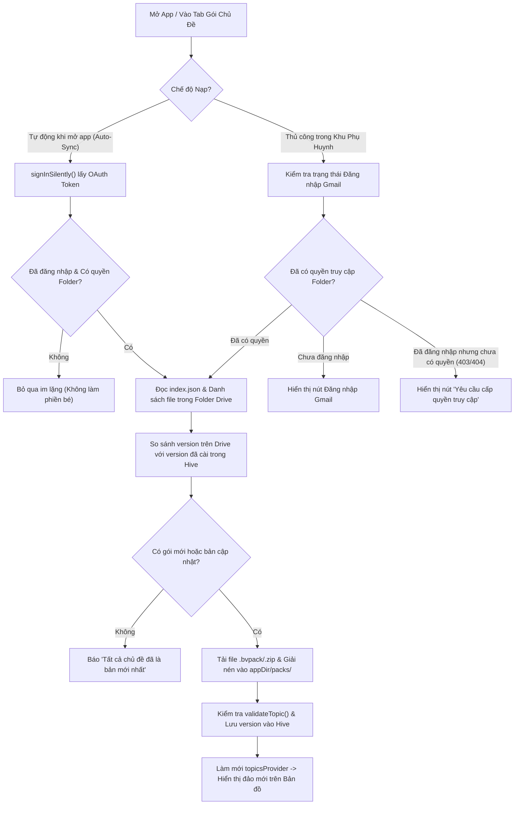

# Kế Hoạch Triển Khai: Nạp Chủ Đề Mới Từ Google Drive

## 1. Đánh Giá Phương Án & Kiến Trúc Đã Chọn

Hệ thống được xây dựng theo kiến trúc **Kho nội dung có kiểm soát quyền truy cập (Authenticated Cloud Pack Delivery)**:

* **Phân quyền Folder Google Drive (Phương án B - Restricted + Google Sign-In):**
  * **Folder đích:** `10d5w1ZMGNRy4OmdX6_6nnhpaIu1H6hHm` ([Link Google Drive](https://drive.google.com/drive/folders/10d5w1ZMGNRy4OmdX6_6nnhpaIu1H6hHm?usp=drive_link))
  * **Ưu điểm:** Bảo vệ toàn diện kho gói bài học. Chỉ những tài khoản Gmail được chủ sở hữu duyệt quyền **Viewer (Chỉ xem)** trên Google Drive mới có thể tải được danh mục và gói bài học.
  * **Luồng Xin Quyền Truy Cập (Request Access Flow):**
    1. Phụ huynh bấm **"Đăng nhập Gmail"** trong tab *Gói chủ đề* (sử dụng OAuth2 với scope chỉ đọc `drive.readonly`).
    2. App kiểm tra quyền truy cập vào Folder `10d5w1ZMGNRy4OmdX6_6nnhpaIu1H6hHm`.
    3. Nếu Gmail chưa được cấp quyền (API trả về `403/404`), app hiển thị thông báo rõ ràng kèm nút **"Gửi yêu cầu cấp quyền truy cập"** $\rightarrow$ mở trang Google Drive của folder để phụ huynh bấm *Request Access* (chủ folder sẽ nhận được email từ Google Drive và chỉ cần bấm *Approve/Chấp nhận* trên điện thoại hoặc máy tính).
* **Quản lý gói qua `index.json` + File nén (`.bvpack` / `.zip`):**
  * Kiểm tra phiên bản cực nhẹ (chỉ tải file `index.json` vài KB khi mở app để so sánh `version`).
  * Hỗ trợ **Fallback thông minh**: Nếu chỉ bỏ nhanh file `.bvpack` hoặc `.zip` lên folder mà chưa kịp sửa `index.json`, app vẫn tự động phát hiện file `.zip`/`.bvpack` mới qua `modifiedTime` của Drive API để nạp luôn.
* **Đồng bộ ngầm khi mở App (Background Auto-Sync):**
  * Khi công tắc **"Tự động nạp khi mở app"** bật, app sử dụng `signInSilently()` để lấy lại phiên đăng nhập Gmail mà không làm phiền bé, tải ngầm gói mới và tự làm mới bản đồ đảo học tập kèm thông báo nhẹ khi hoàn tất.

---

## 2. Cấu Trúc Thư Mục Trên Google Drive

Trong folder Google Drive `10d5w1ZMGNRy4OmdX6_6nnhpaIu1H6hHm`, đặt file `index.json` và các file gói nén:

```text
📁 10d5w1ZMGNRy4OmdX6_6nnhpaIu1H6hHm (Google Drive Folder)
 ├── 📄 index.json
 ├── 📦 t06_fruits.bvpack (hoặc .zip)
 └── 📦 t07_transport.bvpack (hoặc .zip)
```

### Mẫu cấu trúc `index.json`
```json
{
  "updated_at": "2026-11-23T22:30:00Z",
  "packs": [
    {
      "id": "t06_fruits",
      "version": 1,
      "file": "t06_fruits.bvpack",
      "title_en": "Yummy Fruits",
      "title_vi": "Trái cây ngon ngọt",
      "word_count": 8
    }
  ]
}
```

### Cấu trúc bên trong mỗi file `.bvpack` / `.zip`
```text
📦 t06_fruits.bvpack
 ├── 📄 topic.json          (Cấu trúc giống hệt t01..t05.json)
 ├── 📁 images/
 │    ├── 📁 map/           (island_t06_fruits.png)
 │    ├── 📁 songs/         (cover_s06_fruits.png)
 │    └── 📁 topics/t06_fruits/ (<word>.png)
 └── 📁 audio/
      ├── 📁 words/         (<word>.mp3)
      ├── 📁 sentences/     (<sentence>.mp3)
      └── 📁 songs/         (s06_fruits_song.mp3)
```

---

## 3. Luồng Hoạt Động (Workflow)



---

## 4. Chi Tiết Các Hạng Mục Triển Khai Trong Code

### Bước 1: Bổ sung thư viện & Cấu hình (`pubspec.yaml`)
* Thêm các package vào `kids_english_app/app/pubspec.yaml`:
  * `google_sign_in`: Đăng nhập Gmail & lấy OAuth2 Access Token với scope `https://www.googleapis.com/auth/drive.readonly`.
  * `http`: Gọi REST API Google Drive v3 (`files.list` và `files.get?alt=media`).
  * `url_launcher`: Mở trang Google Drive Folder khi phụ huynh bấm *"Yêu cầu cấp quyền truy cập"*.

### Bước 2: Khắc phục & Kết nối `FileContentSource` (`main.dart` & `providers.dart`)
* Hiện tại trong `lib/app/providers.dart`, `contentSourcesProvider` mới chỉ đăng ký `[AssetContentSource()]`, chưa gắn `FileContentSource`.
* Cập nhật `main.dart` và `providers.dart` để luôn nạp `[AssetContentSource(), FileContentSource(Directory('${appDir.path}/packs'))]`. Nhờ đó mọi gói tải từ Google Drive hoặc nạp từ máy sẽ lập tức xuất hiện trên Bản đồ của bé (và ghi đè nếu là bản cập nhật của chủ đề cũ).

### Bước 3: Mở rộng Lưu trữ Cài đặt & Version (`storage.dart` & `providers.dart`)
* Thêm các khóa trong `SettingKeys`:
  * `autoSyncDrive` (`bool`, mặc định `false`): Bật/tắt tự động nạp khi mở app.
  * `driveFolderId` (`String`, mặc định `'10d5w1ZMGNRy4OmdX6_6nnhpaIu1H6hHm'`).
  * `lastDriveSyncAt` (`String?`): Thời điểm đồng bộ thành công gần nhất.
  * `installedPackVersions` (`Map<String, int>`): Lưu version hoặc timestamp của từng `topicId` đã cài để chỉ tải những gói mới hoặc có `version` cao hơn.

### Bước 4: Xây dựng `DriveSyncService` (`lib/data/drive_sync_service.dart`)
* **Xác thực Gmail:**
  * `signIn()`, `signInSilently()`, `signOut()`.
* **Kiểm tra quyền & Quét Folder Drive (`10d5w1ZMGNRy4OmdX6_6nnhpaIu1H6hHm`):**
  * Gọi `GET https://www.googleapis.com/drive/v3/files?q='<folderId>'+in+parents+and+trashed=false&fields=files(id,name,mimeType,modifiedTime,size)`.
  * Phân loại trạng thái rõ ràng: `notSignedIn`, `noPermission` (khi folder trả về rỗng và check metadata folder báo `403/404`), `ready`.
  * Hỗ trợ fallback đọc danh sách file public nếu folder đang bật chế độ chia sẻ công khai để test nhanh.
  * Đọc `index.json` (nếu có) và kết hợp với danh sách file `.bvpack`/`.zip` trong folder.
* **Tải & Cài đặt Gói:**
  * Tải nội dung binary qua `GET https://www.googleapis.com/drive/v3/files/<fileId>?alt=media`.
  * Giải nén vào thư mục tạm $\rightarrow$ đọc `topic.json` và chạy `validateTopic()` để đảm bảo gói không bị lỗi cấu trúc $\rightarrow$ di chuyển vào `${appDir.path}/packs/<topicId>` $\rightarrow$ cập nhật version vào Hive.

### Bước 5: Nâng cấp Giao diện Khu Phụ Huynh (`topic_packs_tab.dart`)
* Thiết kế Card **"Đồng bộ từ Google Drive"**:
  * **Khu vực Tài khoản Gmail:** Hiển thị email đang kết nối + nút *Đăng nhập Gmail* / *Đổi tài khoản*.
  * **Khu vực Quyền truy cập:**
    * Nếu chưa có quyền vào folder: Hiển thị cảnh báo màu cam + nút **"Gửi yêu cầu cấp quyền truy cập"** (mở đúng link folder Google Drive để bấm *Request Access*).
    * Nếu đã có quyền: Hiển thị trạng thái *"Đã kết nối kho chủ đề"* + thời gian đồng bộ gần nhất.
  * **Hai chế độ nạp theo yêu cầu:**
    1. Công tắc (`SwitchListTile`): **"Tự động kiểm tra & nạp chủ đề mới khi mở app"**.
    2. Nút bấm (`FilledButton`): **"Kiểm tra & Nạp từ Google Drive ngay"** (hiển thị tiến trình tải chi tiết từng gói).
* Giữ nguyên tính năng **"Chọn file gói từ thiết bị (.bvpack / .zip)"** bên dưới để làm phương án dự phòng offline.
* Bổ sung nút **Xóa gói cài thêm** cho từng chủ đề không phải built-in trong danh sách.

### Bước 6: Kích hoạt Đồng bộ ngầm khi mở App (`screens.dart`)
* Khi khởi tạo `KidHomeScreen` (lần đầu mở app trong phiên):
  * Nếu `settings.autoSyncDrive == true`, gọi ngầm `driveSyncService.syncInBackground()`.
  * Nếu tải được $N > 0$ chủ đề mới/cập nhật: tự động gọi `ref.invalidate(topicsProvider)` và hiển thị thanh thông báo nhỏ góc màn hình: *"🎉 Đã cập nhật $N$ chủ đề mới từ Google Drive!"*.

### Bước 7: Công cụ đóng gói mẫu & Tạo `index.json` (`tools/pack_topic.dart`)
* Tạo script tiện ích `dart run tools/pack_topic.dart` giúp tự động đóng gói một chủ đề mẫu (ví dụ `t06_fruits.bvpack`) và sinh file `index.json` chuẩn để upload ngay lên Folder Google Drive `10d5w1ZMGNRy4OmdX6_6nnhpaIu1H6hHm` và test thực tế.

---

## 5. Lưu Ý Về Cấu Hình Google OAuth Trên Android

Để `google_sign_in` trên Android hiển thị hộp thoại chọn tài khoản Gmail và cấp token Drive API, Google yêu cầu đăng ký cặp **`applicationId` (`com.bevui.be_vui_tieng_anh`) + mã `SHA-1` của máy build** trong Google Cloud Console (miễn phí 100%).

Trong quá trình triển khai:
1. Trích xuất sẵn mã **SHA-1** trên máy build và hướng dẫn tạo OAuth Client ID trên Google Cloud Console.
2. Tích hợp thêm chế độ **Hybrid Fallback (Public Folder Fallback)** để ngay cả khi chưa kịp cấu hình Google Cloud Console hoặc đang mở quyền folder tạm thời để test trên máy ảo, tính năng tải `index.json` và `.bvpack` từ folder `10d5w1ZMGNRy4OmdX6_6nnhpaIu1H6hHm` vẫn hoạt động và kiểm thử được ngay lập tức.
