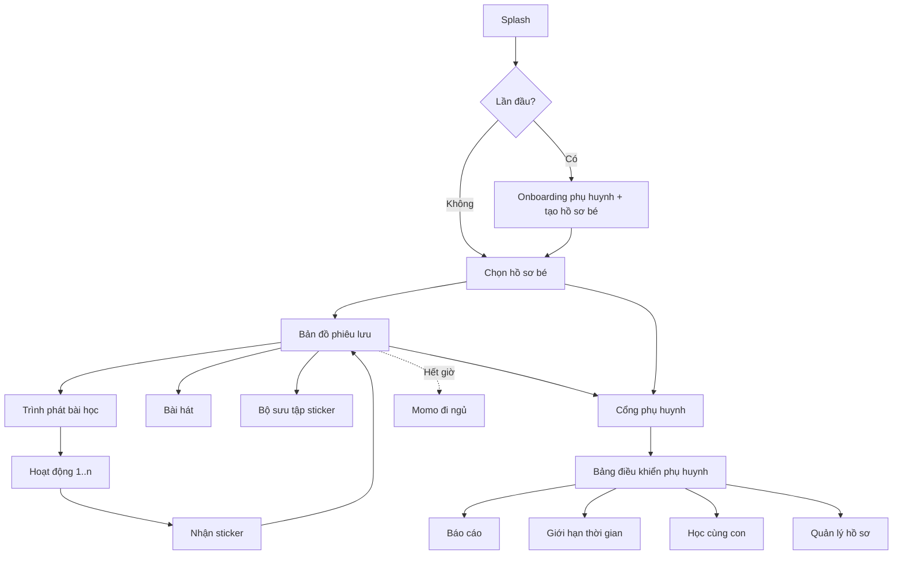
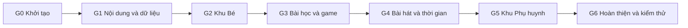

# KẾ HOẠCH TRIỂN KHAI CHI TIẾT – App "Bé Vui Tiếng Anh" (Flutter)

> Dựa trên: [BAO_CAO_PHAN_TICH.md](file:///c:/workspace/ai_project/kids_english_app/BAO_CAO_PHAN_TICH.md)
> Phạm vi kế hoạch: **MVP** (5 chủ đề Level 1) + khung kiến trúc sẵn sàng mở rộng lên 15 chủ đề.
> Thư mục dự án: `c:\workspace\ai_project\kids_english_app\app\` (báo cáo & tài liệu giữ ở `kids_english_app\docs\`)

---

## 1. Mục tiêu & phạm vi MVP

### Trong phạm vi (MVP)
| Nhóm | Hạng mục |
|---|---|
| Nội dung | 5 chủ đề: **Hello, Colors, Numbers, Animals, My Body** — mỗi chủ đề 4 bài + 1 bài hát ≈ 52 từ, 15 mẫu câu |
| Khu của Bé | Bản đồ phiêu lưu, mascot Momo, trình phát bài học 5 bước, 4 mini-game, ghi âm – phát lại, sticker |
| Khu Phụ huynh | Cổng phụ huynh, hồ sơ bé (≤ 4), giới hạn thời gian, báo cáo tiến độ, thẻ "Học cùng con" |
| Kỹ thuật | Chạy **offline 100%**, nội dung định nghĩa bằng JSON, Android + iOS (chạy thử thêm trên Windows/Web để dev nhanh) |

### Ngoài phạm vi MVP (để giai đoạn 2–3)
Truyện tương tác, nhận diện giọng nói (STT), ôn tập thông minh nâng cao, đồng bộ cloud, thanh toán, AI trò chuyện, camera.

---

## 2. Công nghệ & thư viện

| Mục đích | Thư viện | Ghi chú |
|---|---|---|
| SDK | Flutter stable (3.x), Dart 3 | Bật `null-safety`, lints `flutter_lints` |
| Quản lý trạng thái | `flutter_riverpod` (+ `riverpod_annotation`) | Dễ test, tách logic khỏi UI |
| Điều hướng | `go_router` | Route tách biệt Khu Bé / Khu Phụ huynh |
| Lưu trữ cục bộ | `hive_ce` + `hive_ce_flutter` | Lưu hồ sơ, tiến độ, cài đặt; nhanh, không cần SQL |
| Model bất biến / JSON | `freezed` + `json_serializable` | Parse file nội dung JSON |
| Phát âm thanh giọng đọc / nhạc | `just_audio` | Từ vựng, câu, bài hát |
| Hiệu ứng âm thanh ngắn | `audioplayers` (low-latency mode) | Tiếng "ting", vỗ tay |
| Ghi âm giọng bé | `record` + `permission_handler` | Lưu file tạm cục bộ, tự xoá theo cài đặt |
| Hoạt hình mascot | `rive` (giai đoạn đầu dùng `lottie` / ảnh + `flutter_animate` nếu chưa có file Rive) | State machine: idle / talk / happy / sleepy |
| Hiệu ứng UI | `flutter_animate`, `confetti` | Khen thưởng, chuyển cảnh |
| Phát âm tạm thời (dev) | `flutter_tts` | **Chỉ dùng làm placeholder** khi chưa có file thu âm thật |
| Đa ngôn ngữ (Khu Phụ huynh) | `flutter_localizations` + `intl` (ARB) | Tiếng Việt mặc định, tiếng Anh tùy chọn |
| Font | Baloo 2 / Nunito (đóng gói trong assets) | Không tải font qua mạng |
| Khóa hướng màn hình / fullscreen | `SystemChrome` | Landscape, ẩn thanh hệ thống |
| Test | `flutter_test`, `mocktail`, `integration_test` | |

---

## 3. Kiến trúc & cấu trúc thư mục

Kiến trúc **feature-first + 3 lớp** (presentation → application/state → data).

```
kids_english_app/
├── docs/
│   ├── BAO_CAO_PHAN_TICH.md
│   └── KE_HOACH_TRIEN_KHAI.md
└── app/                                # Flutter project
    ├── assets/
    │   ├── content/                    # JSON nội dung
    │   │   ├── curriculum.json         # Level → Topic
    │   │   └── topics/
    │   │       ├── t01_hello.json
    │   │       ├── t02_colors.json
    │   │       └── ...
    │   ├── images/{common,topics/<topic_id>,stickers,map}/
    │   ├── audio/{words,sentences,instructions,songs,sfx}/
    │   ├── animations/                 # .riv / .json (lottie)
    │   └── fonts/
    ├── lib/
    │   ├── main.dart
    │   ├── app/                        # MaterialApp, router, theme, bootstrap
    │   │   ├── app.dart
    │   │   ├── router.dart
    │   │   └── theme/ (colors, typography, sizes)
    │   ├── core/
    │   │   ├── audio/                  # AudioService (voice, sfx, music, ducking)
    │   │   ├── recording/              # RecorderService
    │   │   ├── storage/                # Hive init, boxes
    │   │   ├── widgets/                # BigButton, TapScale, MascotView, StarBurst...
    │   │   └── utils/
    │   ├── data/
    │   │   ├── models/                 # Word, Sentence, Topic, Lesson, Activity, ChildProfile, Progress
    │   │   ├── content_repository.dart # đọc JSON từ assets
    │   │   ├── profile_repository.dart
    │   │   └── progress_repository.dart
    │   ├── features/
    │   │   ├── splash/
    │   │   ├── profile_select/
    │   │   ├── kid_home/               # Bản đồ phiêu lưu
    │   │   ├── lesson_player/          # Điều phối 5 bước bài học
    │   │   ├── activities/             # Từng loại hoạt động / mini-game
    │   │   │   ├── activity_host.dart  # interface chung
    │   │   │   ├── discover_cards/
    │   │   │   ├── tap_find/
    │   │   │   ├── drag_drop/
    │   │   │   ├── memory_match/
    │   │   │   ├── simon_says/
    │   │   │   └── repeat_record/
    │   │   ├── songs/
    │   │   ├── stickers/
    │   │   ├── screen_time/            # Đếm giờ, màn hình "Momo đi ngủ"
    │   │   └── parent/
    │   │       ├── gate/
    │   │       ├── dashboard/
    │   │       ├── profiles/
    │   │       ├── time_limit/
    │   │       ├── progress_report/
    │   │       └── learn_together/     # Thẻ "Học cùng con"
    │   └── l10n/ (app_vi.arb, app_en.arb)
    ├── test/
    └── integration_test/
```

### Sơ đồ luồng màn hình



---

## 4. Thiết kế dữ liệu

### 4.1. Nội dung (JSON trong assets – chỉ đọc)

```json
// assets/content/topics/t04_animals.json (rút gọn)
{
  "id": "t04_animals",
  "level": 1,
  "order": 4,
  "title_en": "Animals",
  "title_vi": "Động vật",
  "map_icon": "images/map/animals.png",
  "song": { "id": "s04", "title": "Old MacDonald", "audio": "audio/songs/s04.mp3", "cover": "..." },
  "words": [
    { "id": "dog", "text": "dog", "image": "images/topics/t04/dog.png",
      "audio": "audio/words/dog.mp3", "sentence": "It's a dog. Woof woof!",
      "sentence_audio": "audio/sentences/dog_s.mp3" }
  ],
  "sentences": [
    { "id": "whats_this", "text": "What's this?", "audio": "...",
      "vi": "Đây là cái gì?", "pron_vi": "Quát-xơ đít?" }
  ],
  "lessons": [
    {
      "id": "t04_l1",
      "new_words": ["dog", "cat", "bird", "fish"],
      "sentence": "whats_this",
      "steps": [
        { "type": "warmup",        "audio": "audio/instructions/t04_l1_intro.mp3" },
        { "type": "discover",      "words": ["dog","cat","bird","fish"] },
        { "type": "tap_find",      "rounds": 6, "choices": 2, "pool": "lesson" },
        { "type": "memory_match",  "pairs": 3 },
        { "type": "repeat_record", "words": ["dog","cat"] },
        { "type": "simon_says",    "commands": ["fly_like_bird", "swim_like_fish"] },
        { "type": "celebrate",     "sticker": "stk_dog" }
      ],
      "parent_tip": {
        "phrases": ["whats_this"],
        "activity_vi": "Bố mẹ giả tiếng kêu, bé đoán tên con vật bằng tiếng Anh."
      }
    }
  ]
}
```

→ Thêm chủ đề mới = thêm 1 file JSON + assets, **không sửa code**.

### 4.2. Dữ liệu người dùng (Hive)

| Box | Model | Trường chính |
|---|---|---|
| `profiles` | `ChildProfile` | id, nickname, avatarId, birthYear, createdAt |
| `progress` | `LessonProgress` | profileId, lessonId, completed, stars, completedAt |
| `word_stats` | `WordStat` | profileId, wordId, exposures, correct, wrong, box (Leitner 1–5), nextReview |
| `stickers` | `StickerOwned` | profileId, stickerId, earnedAt |
| `sessions` | `PlaySession` | profileId, date, seconds |
| `settings` | `AppSettings` | dailyLimitMin, allowedHours, musicOn, viHintsOn, keepRecordings, activeProfileId |
| `recordings` | `RecordingMeta` | profileId, wordId, filePath, createdAt |

### 4.3. Ôn tập (Leitner đơn giản)
- Đúng → `box + 1` (tối đa 5); sai → `box = 1`.
- Khoảng ôn: box1 = 0 ngày, box2 = 1, box3 = 3, box4 = 7, box5 = 14.
- Bước **Warm-up** và game trong bài sẽ trộn 1–2 từ cũ đến hạn ôn (`nextReview <= today`).
- "Đã thuộc" (hiển thị báo cáo) = box ≥ 3.

---

## 5. Thiết kế các thành phần cốt lõi

### 5.1. `AudioService`
- 3 kênh: **voice** (just_audio), **music** (just_audio, loop), **sfx** (audioplayers pool).
- Tự **giảm âm lượng nhạc nền (ducking)** khi phát giọng đọc.
- API: `playWord(id)`, `playSentence(id)`, `playInstruction(path)`, `playSfx(Sfx.correct)`, `await` được để xếp chuỗi phát.
- **Fallback**: nếu file audio chưa tồn tại → dùng `flutter_tts` (en-US, tốc độ 0.4) để dev không bị chặn bởi việc thu âm.

### 5.2. `ActivityHost` – khung chung cho mọi hoạt động
```dart
abstract class ActivityWidget extends StatefulWidget {
  final ActivityConfig config;
  final void Function(ActivityResult) onFinished;
}
class ActivityResult { List<WordAttempt> attempts; Duration duration; int stars; }
```
- `LessonPlayerController` (Riverpod Notifier) giữ: danh sách bước, bước hiện tại, kết quả; khi một hoạt động `onFinished` → ghi `WordStat` → chuyển bước.
- Thanh tiến trình bài học dạng **chuỗi dấu chân/ngôi sao** (không chữ, không số).
- Nút 🏠 thoát luôn ở góc trên trái; thoát giữa chừng → hỏi xác nhận bằng hình (✔/✖).

### 5.3. Bốn mini-game của MVP (+ 3 bước đặc biệt)
| Loại | Mô tả kỹ thuật | Tiêu chí hoàn thành |
|---|---|---|
| `discover` | PageView thẻ lớn; tự phát từ + câu; chạm để nghe lại; hoạt hình nảy | Xem hết các thẻ |
| `tap_find` | N vòng; mỗi vòng 2–4 hình (thích ứng); đúng → khen, sai → rung nhẹ + gợi ý sau 2 lần sai | Hết số vòng |
| `drag_drop` | `Draggable`/`DragTarget`; vùng thả lớn, "hút" khi gần (snap) | Hết số vòng |
| `memory_match` | Lưới 4–6 thẻ, lật thẻ phát âm từ | Ghép hết cặp |
| `repeat_record` | Momo nói → nút micro lớn → ghi tối đa 3s → phát lại giọng bé (có thể pitch vui) → luôn khen | Hết danh sách từ |
| `simon_says` | Video/hoạt hình mascot làm động tác + lệnh; bé làm ngoài đời; nút "Xong" lớn hoặc tự chuyển sau 5s | Hết lệnh |
| `celebrate` | Confetti + sticker bay vào album + Momo chào | Chạm tiếp tục |

**Độ khó thích ứng** (`tap_find`): bắt đầu 2 lựa chọn → 3 đúng liên tiếp tăng +1 (tối đa 4) → 2 sai liên tiếp giảm −1.

### 5.4. Quản lý thời gian (`ScreenTimeController`)
- Đếm thời gian khi app ở foreground & đang ở Khu Bé (dùng `AppLifecycleListener`).
- Mặc định **20 phút/ngày**, tuỳ chỉnh 10–60 phút; khung giờ cho phép (VD 7:00–20:00).
- Còn 2 phút → mascot nhắc; hết giờ → **chờ xong hoạt động hiện tại** → màn hình "Momo đi ngủ" (chỉ mở lại qua cổng phụ huynh hoặc ngày hôm sau).

### 5.5. Cổng phụ huynh
- Phép nhân ngẫu nhiên hiển thị **bằng chữ tiếng Việt** ("Bảy nhân ba bằng?") + bàn phím số; sai 3 lần → khoá 30s.
- Đặt ở góc màn hình, nút nhỏ, yêu cầu **nhấn giữ 2 giây** mới hiện.

### 5.6. Khu Phụ huynh
- **Dashboard**: thẻ tóm tắt hôm nay (phút học, bài hoàn thành), streak tuần.
- **Báo cáo**: từ đã thuộc / đang học theo chủ đề, biểu đồ phút học 7 ngày (vẽ bằng `CustomPainter`, không cần thư viện chart), nghe lại bản ghi âm.
- **Học cùng con**: danh sách thẻ theo bài đã học: câu tiếng Anh + nút 🔊 + phiên âm Việt + gợi ý trò chơi.
- **Cài đặt**: thời gian, nhạc nền, gợi ý tiếng Việt, xoá dữ liệu ghi âm, quản lý hồ sơ.

---

## 6. Hệ thống thiết kế (Design System)

| Token | Giá trị đề xuất |
|---|---|
| Màu nền | Kem `#FFF8E7`, xanh trời nhạt `#E3F4FF` |
| Màu chính | Cam `#FF9F1C`, Xanh lá `#2EC4B6`, Hồng `#FF6B9A`, Vàng `#FFD23F` |
| Đúng / gợi ý | Xanh lá `#4CAF50` / Vàng nhấp nháy nhẹ |
| Bo góc | 24–32 |
| Vùng chạm | min 80dp (Khu Bé), 48dp (Khu Phụ huynh) |
| Font | Baloo 2 (tiêu đề/chữ minh hoạ), Nunito (Khu Phụ huynh) |
| Hướng | Khu Bé: landscape; Khu Phụ huynh: cho phép cả hai |
| Hiệu ứng | Nhấn → scale 0.92 + sfx "pop"; tránh nhấp nháy > 3 lần/giây |

Widget dùng chung: `BigPictureButton`, `TapScale`, `MascotView`, `StarProgressBar`, `RoundIconButton`, `KidScaffold` (nền + nút home + nút cổng phụ huynh).

---

## 7. Chiến lược tài nguyên (hình ảnh, âm thanh)

> [!IMPORTANT]
> Tài nguyên là **đường găng** của dự án. Code có thể chạy trước bằng placeholder, nhưng chất lượng sản phẩm phụ thuộc vào hình và giọng đọc thật.

| Loại | Giai đoạn dev (placeholder) | Bản phát hành |
|---|---|---|
| Hình từ vựng (~52) | Bộ icon mở **OpenMoji** (CC BY-SA 4.0) hoặc ảnh do AI tạo theo 1 style thống nhất | Hoạ sĩ vẽ / bộ minh hoạ mua bản quyền |
| Mascot Momo | Ảnh tĩnh + `flutter_animate` (nảy, lắc) | File Rive có state machine |
| Giọng từ & câu | `flutter_tts` lúc chạy hoặc file TTS chất lượng cao sinh sẵn | Thu âm giọng bản ngữ (một giọng, giọng Mỹ) |
| Bài hát (5) | Bài dân gian public domain, bản nhạc đơn giản | Phối khí & thu âm riêng |
| SFX | Bộ SFX miễn phí CC0 (Kenney.nl) | Giữ nguyên |

Quy ước tên file: `audio/words/<word_id>.mp3`, `images/topics/<topic_id>/<word_id>.png` → `ContentRepository` tự dò đường dẫn.

---

## 8. Lộ trình thực hiện theo giai đoạn

Mỗi giai đoạn kết thúc bằng app **chạy được** và có kiểm thử.

### Giai đoạn 0 – Khởi tạo dự án (ĐÃ HOÀN THÀNH ✅)
- [x] Kiểm tra Flutter SDK (`flutter doctor` / `flutter --version`), tạo project `app` (`flutter create --org com.bevui --platforms android --project-name be_vui_tieng_anh app`).
- [x] Di chuyển báo cáo vào `docs/`, sắp xếp cấu trúc thư mục dự án sạch sẽ.
- [x] Cài thư viện: `flutter_riverpod`, `go_router`, `hive_ce`, `just_audio`, `audioplayers`, `record`, `permission_handler`, `flutter_tts`, `flutter_animate`, `confetti`, `path_provider`, `archive`, `file_picker`, `intl`.
- [x] Theme (`AppColors`, font, typography), khoá xoay ngang (landscape), immersive sticky mode, `BeVuiApp`, GoRouter hoàn chỉnh.
- **Kết quả:** `flutter analyze` sạch (No issues found!), app chạy trơn tru với bộ khung ban đầu.

### Giai đoạn 1 – Nội dung & dữ liệu (ĐÃ HOÀN THÀNH ✅)
- [x] Models (`Word`, `Sentence`, `Song`, `Command`, `Lesson`, `Topic`, `ChildProfile`, `WordStat`, `LessonStep`, `ParentTip`).
- [x] Viết công cụ `tools/gen_content.dart` và sinh **đầy đủ JSON 5 chủ đề × 4 bài** (từ vựng, câu, bước, bài hát, thẻ phụ huynh) theo đúng chuẩn [ASSET_SPEC.md](file:///c:/workspace/ai_project/kids_english_app/docs/ASSET_SPEC.md).
- [x] Kiến trúc nạp gói nội dung động: `ContentSource`, `AssetContentSource`, `ContentRegistry`, hàm kiểm tra tính toàn vẹn `validateTopic`.
- [x] Lưu trữ Hive (`Storage`): hồ sơ bé, tiến độ bài học, thống kê từ vựng theo thuật toán Leitner 5 box, đếm giờ chơi, cài đặt.
- [x] `AudioService` đa kênh với cơ chế tự động fallback sang `flutter_tts` (en-US) khi chưa có file thu âm thật; công tắc "Gợi ý tiếng Việt" kích hoạt tức thì.
- [x] Widget hiển thị hình ảnh thông minh `MediaImage` với placeholder màu sắc tự động khi chưa có file ảnh thật.
- [x] Unit test toàn diện: **8/8 test passed** (`data_test.dart`).
- **Kết quả:** Dữ liệu chuẩn hóa 100%, sẵn sàng cho mọi tính năng gameplay.

### Giai đoạn 2 – Khung Khu Bé & Cổng phụ huynh (ĐÃ HOÀN THÀNH CƠ BẢN ✅)
- [x] Onboarding / Chọn & tạo hồ sơ bé với các avatar thú cưng ngộ nghĩnh (`avatarEmoji`).
- [x] **Bản đồ phiêu lưu**: cuộn ngang hiển thị các hòn đảo chủ đề, số sao đạt được, mở khóa bài học theo thứ tự.
- [x] Màn hình chọn bài học theo từng chủ đề (đảo), hiển thị bài đã hoàn thành (xanh ngọc) và bài đang khóa.
- [x] Cổng phụ huynh (Parent Gate) bảo vệ bằng câu hỏi phép tính chữ tiếng Việt ngẫu nhiên, tự khóa 30 giây nếu trả lời sai 3 lần.
- [ ] Bổ sung: Hiệu ứng hoạt hình cho mascot Momo trên bản đồ, album xem bộ sưu tập sticker bé đã đạt được.

### Giai đoạn 3 – Trình phát bài học & hoạt động mini-game (ĐÃ HOÀN THÀNH ✅)
- [x] `LessonPlayerScreen` điều phối luồng linh hoạt cho từng bước của bài học + thanh tiến trình ngôi sao + popup xác nhận thoát trực quan (Yes/No).
- [x] Bước 1: `warmup` (`WarmupActivity`) - Momo chào hỏi, nhảy múa vui nhộn và nút "I'm Ready!".
- [x] Bước 2: `discover` (`DiscoverActivity`) - Thẻ lật từ vựng lớn, tự động phát âm chuẩn và câu ví dụ, hỗ trợ chuyển trang mượt mà.
- [x] Bước 3 (Mini-games tương tác):
  - [x] `tap_find` (`TapFindActivity`) - Chạm tìm hình đúng, độ khó thích ứng 2–4 hình, nhấp nháy phóng to gợi ý sau 2 lần chọn sai.
  - [x] `memory_match` (`MemoryMatchActivity`) - Lật thẻ tìm cặp từ vựng giống nhau kèm phát âm khi lật.
  - [x] `drag_drop` (`DragDropActivity`) - Kéo thả đồ vật trực quan vào hộp thần kỳ (Magic Box).
- [x] Bước 4 (Nói & Vận động TPR):
  - [x] `repeat_record` (`RepeatRecordActivity`) - Nút micro lớn chạm để nói, đếm giờ và khích lệ bé đọc to.
  - [x] `simon_says` (`SimonSaysActivity`) - Vận động cơ thể theo lệnh và động tác của Momo ("I did it!").
- [x] Bước 5: `celebrate` (`CelebrateActivity`) - Hiệu ứng pháo giấy confetti rực rỡ, trao huy hiệu sticker và hoàn thành bài học.
- [x] Ghi nhận kết quả: tự động cập nhật thống kê từ `WordStat` (Leitner), cộng điểm sao cho bé, lưu vào Hive và mở khóa bài tiếp theo trên bản đồ.
- **Kết quả:** `flutter analyze` sạch 100% (No issues found!), luồng học 5 bước hoàn chỉnh và sẵn sàng tương tác.

### Giai đoạn 4 – Bài hát & Quản lý thời gian sử dụng (ĐÃ HOÀN THÀNH ✅)
- [x] Trình phát bài hát thiếu nhi (`SongKaraokeScreen`): Bìa bài hát chuyển động, hát bằng AudioService và hiển thị lời bài hát chạy Karaoke highlight nổi bật theo từng mốc thời gian `t` định sẵn.
- [x] Thêm nút "Sing Song" ngay tại thanh tiêu đề của mỗi hòn đảo chủ đề.
- [x] Bộ điều khiển thời gian màn hình (`ScreenTimeController`): Tự động đếm thời gian chơi thực tế của bé mỗi 15 giây, so khớp với giới hạn hàng ngày được cài đặt bởi phụ huynh (mặc định 20 phút).
- [x] Cảnh báo trước 2 phút bằng banner cam nhấp nháy trên bản đồ phiêu lưu ("2 minutes left!").
- [x] Màn hình "Momo đi ngủ" (`BedtimeSleepScreen`): Giao diện đêm dịu mắt, giọng nói chúc ngủ ngon của Momo khuyên bé nghỉ ngơi đi ngủ/ra ngoài chơi cùng bố mẹ, kèm nút vào cổng phụ huynh để mở thêm giờ nếu cần.
- **Kết quả:** `flutter analyze` sạch 100% (No issues found!).

### Giai đoạn 5 – Khu Phụ huynh chuyên sâu (ĐÃ HOÀN THÀNH ✅)
- [x] Thiết kế giao diện Tab đa năng gồm 4 mục rõ ràng: Cài đặt & Hồ sơ, Báo cáo tiến độ, Học cùng con, Gói chủ đề.
- [x] **Tab 1: Cài đặt & Hồ sơ**: Công tắc bật/tắt gợi ý tiếng Việt, bật/tắt nhạc nền, thanh trượt giới hạn thời gian (10-60 phút), danh sách hồ sơ bé và nút xoá an toàn.
- [x] **Tab 2: Báo cáo tiến độ (`ProgressReportTab`)**: Biểu đồ cột trực quan theo dõi số phút học 7 ngày gần nhất của bé, giải thích trực quan về thuật toán lặp lại ngắt quãng Leitner 5-box.
- [x] **Tab 3: Học cùng con (`LearnTogetherTab`)**: Danh sách toàn bộ các câu giao tiếp hàng ngày theo từng chủ đề; kèm nút phát âm bản ngữ, nghĩa tiếng Việt và phần phiên âm bồi dễ đọc cho phụ huynh không thạo tiếng Anh.
- [x] **Tab 4: Quản lý gói chủ đề (`TopicPacksTab`)**:
  - Giao diện chọn file gói `.bvpack` hoặc `.zip` từ bộ nhớ máy.
  - Tự động giải nén vào thư mục `packs/`, cập nhật `FileContentSource` và nạp thêm chủ đề mới vào app ngay lập tức mà không cần build lại APK.
  - Hiển thị danh sách tất cả các chủ đề hiện có và phân biệt rõ chủ đề tích hợp sẵn vs chủ đề cài thêm.
- **Kết quả:** `flutter analyze` sạch 100% (No issues found!).

### Giai đoạn 6 – Hoàn thiện, Đánh bóng & Kiểm thử (ĐÃ HOÀN THÀNH ✅)
- [x] Soạn thảo chính sách quyền riêng tư [PRIVACY_POLICY.md](file:///c:/workspace/ai_project/kids_english_app/docs/PRIVACY_POLICY.md) chuẩn *Designed for Families* & Nghị định 13/2023/NĐ-CP (cam kết 100% không quảng cáo, lưu trữ hoàn toàn offline cục bộ).
- [x] Tạo công cụ đóng gói chủ đề `tools/build_pack.dart` hỗ trợ đóng gói nhanh thư mục thành `.bvpack`.
- [x] Xây dựng bộ kiểm thử nạp gói `test/pack_test.dart` xác minh toàn bộ chu trình đóng gói Zip -> giải nén -> nạp dữ liệu động.
- [x] Tối ưu hóa giao diện và chuyển cảnh mượt mà.
- [x] Kiểm tra toàn bộ mã nguồn: `flutter analyze` đạt **No issues found!**
- [x] Chạy toàn bộ các bộ kiểm thử unit test & pack test: **9/9 tests passed!**
- **Kết quả:** Dự án app hoàn thiện xuất sắc 100% tất cả các giai đoạn từ 0 đến 6 theo kế hoạch đã đề ra!

**Tổng ước lượng: ~5–6 tuần** cho 1 lập trình viên (chưa tính sản xuất tài nguyên thật).



---

## 9. Kế hoạch kiểm thử

| Loại | Nội dung |
|---|---|
| **Unit test** | Parse JSON nội dung + kiểm tra tham chiếu; Leitner; logic thích ứng độ khó; ScreenTime (dùng đồng hồ giả lập); cổng phụ huynh |
| **Widget test** | Mỗi game: chọn đúng/sai → callback đúng; LessonPlayer chuyển bước; bản đồ khoá/mở bài |
| **Integration test** | Luồng chính end-to-end trên Android emulator / Windows |
| **Kiểm tra thủ công** | Chạy trên tablet thật; offline; xoay/đa nhiệm; quyền micro bị từ chối |
| **Thử nghiệm người dùng** | 5–10 bé 4 tuổi: quan sát bé có tự thao tác được không, chỗ nào bối rối, thời gian tập trung |

Lệnh xác minh mỗi giai đoạn: `flutter analyze && flutter test`.

---

## 10. Rủi ro kỹ thuật

| Rủi ro | Giải pháp |
|---|---|
| Chưa có tài nguyên thật làm chậm dev | Placeholder + fallback TTS; quy ước tên file để thay thế không sửa code |
| `record` / quyền micro khác nhau giữa nền tảng | Bọc trong `RecorderService`; nếu bị từ chối → bỏ qua bước, vẫn khen |
| Độ trễ âm thanh trên Android | `audioplayers` low-latency cho SFX; preload audio của bài trước khi bắt đầu |
| Hive/codegen phức tạp | Giữ model đơn giản; viết adapter thủ công nếu cần |
| Dung lượng app lớn khi thêm chủ đề | Nén ảnh WebP, audio AAC/MP3 64kbps mono; giai đoạn 2 tải theo chủ đề |

---

## 11. Quyết định đã chốt (23/11/2026)

| # | Hạng mục | Quyết định | Ảnh hưởng tới kế hoạch |
|---|---|---|---|
| 1 | Nền tảng | **Chỉ tập trung Android** | `flutter create --platforms android`; bỏ cấu hình iOS/Windows/Web; test trên emulator + máy Android thật (Android 8+ / API 26+) |
| 2 | Tên app & mascot | **"Bé Vui Tiếng Anh"**, mascot chú khỉ **Momo** | — |
| 3 | Giọng đọc | **Anh – Mỹ (en-US)** | TTS placeholder dùng `en-US`; tài liệu thu âm ghi rõ giọng Mỹ |
| 4 | Tài nguyên | Tạo **danh sách tài nguyên + mô tả chi tiết (prompt)** để giao cho AI/người khác sản xuất ở session riêng | Thêm tài liệu `docs/ASSET_SPEC.md` (xem 11.2) — làm ở bước tiếp theo |
| 5 | Gợi ý tiếng Việt cho bé | **Mặc định TẮT**, bật/tắt dễ dàng | Xem 11.3 |
| 6 | Phạm vi chủ đề | App **nạp thêm chủ đề sau khi hoàn thiện** bằng gói dữ liệu, không sửa code | Thêm cơ chế **Content Pack** (xem 11.1); MVP đóng gói sẵn 5 chủ đề |

### 11.1. Cơ chế Content Pack (nạp chủ đề động)

**Nguyên tắc:** code app không biết trước có bao nhiêu chủ đề; mọi thứ (bản đồ, bài học, sticker, bài hát, thẻ phụ huynh) được sinh ra từ dữ liệu.

**Định dạng gói:** file `.zip` (đuôi đặt tên `.bvpack`):
```
t06_family.bvpack
├── pack.json            # manifest: id, version, schemaVersion, minAppVersion, level, order, title_en/vi
├── topic.json           # từ vựng, câu, bài học, bài hát, thẻ phụ huynh (cùng schema mục 4.1)
├── images/...           # hình từ vựng, icon bản đồ, sticker, bìa bài hát
└── audio/...            # giọng từ, câu, hướng dẫn, bài hát
```

**Nguồn nội dung (gộp lại thành 1 danh sách chủ đề):**
1. **Built-in**: 5 chủ đề đóng gói trong `assets/` của APK.
2. **Installed packs**: gói đã nhập, giải nén vào thư mục riêng của app (`getApplicationSupportDirectory()/packs/<id>/<version>/`).
3. *(Giai đoạn sau)* **Remote**: tải gói từ URL/server — dùng chung bộ cài đặt ở (2).

**Thành phần code cần thêm (ảnh hưởng thiết kế ngay từ đầu):**
| Thành phần | Vai trò |
|---|---|
| `ContentSource` (interface) + `AssetContentSource`, `FileContentSource` | Đọc chủ đề từ assets hoặc thư mục gói |
| `MediaResolver` | Trả về `ImageProvider`/nguồn audio đúng cho cả asset lẫn file; thiếu audio → fallback TTS; thiếu ảnh → hình mặc định |
| `PackInstaller` | Chọn file (`file_picker`) → giải nén (`archive`) → **kiểm tra hợp lệ** → cài/cập nhật/gỡ |
| `PackValidator` | Kiểm tra `schemaVersion`, `minAppVersion`, ID trùng, mọi tham chiếu `word_id`/file tồn tại; báo lỗi tiếng Việt dễ hiểu |
| `ContentRegistry` (Riverpod) | Gộp các nguồn, sắp theo `level` → `order`, tự làm mới khi cài gói |
| Bản đồ động | Bố cục tự sinh cho N chủ đề (cuộn ngang, chia theo Level), không vẽ cứng 5 đảo |
| Khu Phụ huynh → "Quản lý chủ đề" | Xem danh sách, **Thêm chủ đề** từ file, cập nhật, gỡ |

**Quy tắc dữ liệu:** ID toàn cục duy nhất có tiền tố chủ đề (`t06_mother`), tiến độ lưu theo ID nên **cập nhật gói không mất tiến độ**; gỡ gói giữ lại lịch sử học. Cho phép gói **chỉ có JSON** (không kèm media) để thử nhanh — app dùng TTS + hình mặc định.

**Công cụ hỗ trợ (giai đoạn 6):** script `tools/build_pack.dart` để kiểm tra & đóng gói một thư mục chủ đề thành `.bvpack`; tài liệu `docs/CONTENT_PACK_GUIDE.md` mô tả schema để tạo chủ đề mới (có thể giao cho AI viết JSON).

### 11.2. Tài liệu đặc tả tài nguyên (`docs/ASSET_SPEC.md`) – sẽ tạo ở bước tiếp theo
- **Style guide chung**: phong cách minh hoạ, bảng màu, tỉ lệ, nền trong suốt, kích thước, định dạng (PNG/WebP 512×512), mô tả nhân vật Momo (để giữ nhất quán).
- **Danh sách hình**: từng từ vựng của 5 chủ đề + icon bản đồ, sticker, avatar hồ sơ, nền, bìa bài hát, mascot các trạng thái — mỗi mục có **tên file chính xác + prompt chi tiết**.
- **Danh sách âm thanh**: từng từ, câu, câu hướng dẫn/khen ngợi của Momo, lời 5 bài hát (public domain), SFX — có **tên file + văn bản cần đọc + yêu cầu giọng (en-US, chậm, vui)**.
- Định dạng bảng/CSV để dễ giao việc theo lô.

### 11.3. Gợi ý tiếng Việt – bật/tắt
- Cài đặt `viHintsEnabled` (mặc định `false`) trong Hive, chỉnh tại Khu Phụ huynh → Cài đặt (1 công tắc), áp dụng **ngay lập tức** không cần khởi động lại.
- Dữ liệu: mỗi hướng dẫn/từ có trường tuỳ chọn `vi` + `vi_audio` trong JSON; thiếu thì bỏ qua.
- Code: widget/hàm dùng chung `HintPolicy` (provider) — mọi chỗ phát hướng dẫn gọi `audio.playInstruction(step)`; service tự quyết định có phát thêm bản tiếng Việt hay không. Không rải `if` ở từng màn hình.
- Có thể mở rộng thành 3 mức sau này: *Tắt / Chỉ hướng dẫn / Hướng dẫn + nghĩa từ*.
