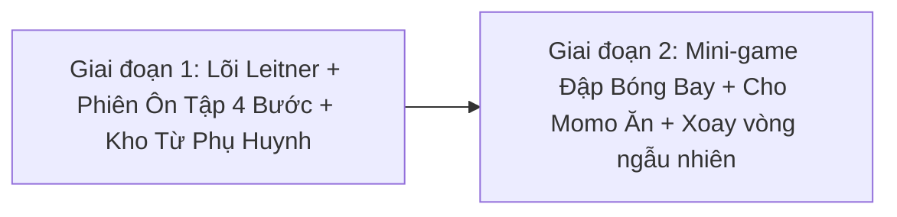

# KẾ HOẠCH TRIỂN KHAI CHI TIẾT: HỆ THỐNG ÔN TẬP THÔNG MINH (SMART REVIEW)
## Ứng dụng "Bé Vui Tiếng Anh" (Flutter)

> **Dựa trên báo cáo:** [BAO_CAO_Y_TUONG_ON_TAP_THONG_MINH.md](file:///c:/workspace/ai_project/kids_english_app/docs/BAO_CAO_Y_TUONG_ON_TAP_THONG_MINH.md)
> **Mục tiêu:** Biến dữ liệu học tập & thuật toán **Leitner (`Box 1..5`)** sẵn có thành một chế độ **Ôn tập đa chủ đề sinh động** cho bé (hỗ trợ cả 5 chủ đề built-in và 20 gói `.bvpack` từ Google Drive) kèm **Kho từ vựng trực quan** cho phụ huynh.

---

## 1. Tổng Quan Kiến Trúc & Phạm Vi

Hệ thống được triển khai theo **2 Giai đoạn (2 Sprints)** độc lập, giai đoạn 1 ra mắt dùng ngay được và giai đoạn 2 bổ sung các mini-game độc quyền cho trải nghiệm lâu dài:



### Nguyên tắc kỹ thuật cốt lõi
1. **Không phá vỡ luồng bài học hiện tại (Zero Breaking Changes):** Mọi nâng cấp cho `TapFindActivity`, `MemoryMatchActivity`, `DragDropActivity`, `RepeatRecordActivity` đều dùng tham số tùy chọn (`wordBaseDirs`), giữ nguyên 100% tương thích với `LessonPlayerScreen`.
2. **Hỗ trợ đa nguồn `baseDir` (Cross-Topic Assets):** Mỗi từ trong phiên ôn tập mang theo `baseDir` của chủ đề chứa nó (`null` nếu là `t01..t05` built-in, hoặc đường dẫn thư mục giải nén `.bvpack` nếu là `t06..t25`), đảm bảo ảnh PNG và âm thanh MP3 luôn nạp chính xác dù trộn 6 từ từ 6 chủ đề khác nhau.
3. **Offline 100% & An toàn cho trẻ 4 tuổi:** Không quảng cáo, không trừ điểm, không "Game Over", thời lượng mỗi phiên ôn tập ~3–4 phút (**6 từ/phiên**).

---

## 2. GIAI ĐOẠN 1: LÕI ÔN TẬP THÔNG MINH LEITNER & KHO TỪ PHỤ HUYNH

### Bước 1.1: Xây dựng Domain & Thuật toán chọn từ (`lib/data/review_planner.dart`)
Tạo file mới `kids_english_app/app/lib/data/review_planner.dart`:

* **Các mô hình dữ liệu:**
  ```dart
  enum ReviewMode { smartMix, weakWordsOnly }

  class ReviewWord {
    final Word word;
    final String topicId;
    final String topicTitleEn;
    final String topicTitleVi;
    final String? baseDir; // null = built-in assets; khác null = thư mục gói .bvpack
    final WordStat? stat;
    // Getter tiện ích:
    int get box => stat?.box ?? 1;
    bool get isMastered => stat?.mastered ?? false;
    bool isDue(DateTime now) => stat == null ? true : stat!.isDue(now);
  }

  class ReviewSummary {
    final List<ReviewWord> learnedWords;   // Toàn bộ từ bé đã học
    final List<ReviewWord> masteredWords;  // Box 3..5
    final List<ReviewWord> learningWords;  // Box 2 (chưa quá hạn)
    final List<ReviewWord> dueOrWeakWords; // Box 1 hoặc isDue(now)
  }
  ```
* **Nguồn thu thập từ đã học (`collectLearnedWords`):**
  * Duyệt toàn bộ `topics` (từ `topicsProvider`):
    * Lấy mọi `wordId` nằm trong `lesson.newWords` của các bài học có `storage.isLessonDone(profileId, lesson.id) == true`.
    * Hợp nhất thêm mọi `wordId` có `storage.wordStat(profileId, wordId) != null` (từ bé đã tương tác trong các game dù chưa xong hết bài).
    * Loại trùng theo `word.id`, gắn kèm `topic.baseDir` và `WordStat`.
* **Thuật toán chọn 6 từ cho phiên ôn tập (`buildSessionWords`):**
  * Điều kiện tối thiểu để mở ôn tập: `learnedWords.length >= 4`.
  * Số từ mỗi phiên: `sessionSize = min(6, learnedWords.length)`.
  * **Chế độ `ReviewMode.smartMix` (Mặc định cho bé trên Bản đồ):**
    1. Sắp xếp nhóm **Ưu tiên 1 (`dueOrWeakWords`)**: ưu tiên `box == 1` & số lần sai `wrong` cao nhất, sau đó tới ngày `nextReview` cũ nhất $\rightarrow$ lấy tối đa **3 từ**.
    2. Nhóm **Ưu tiên 2 (`learningWords` – `Box 2`)**: xáo trộn ngẫu nhiên $\rightarrow$ lấy tối đa **2 từ**.
    3. Nhóm **Ưu tiên 3 (`masteredWords` – `Box 3..5`)**: ưu tiên từ lâu chưa gặp $\rightarrow$ lấy tối đa **1 từ**.
    4. Nếu tổng chưa đủ `sessionSize` (VD: bé mới học xong 1 chủ đề, tất cả đều đang ở Box 1), tự động bù thêm từ các nhóm còn lại theo thứ tự ưu tiên 1 $\rightarrow$ 2 $\rightarrow$ 3.
  * **Chế độ `ReviewMode.weakWordsOnly` (Phụ huynh bấm từ Kho từ vựng):**
    * Lấy toàn bộ tối đa 6 từ từ nhóm `dueOrWeakWords` (ưu tiên `wrong` cao nhất / `box == 1`).

### Bước 1.2: Đồng bộ khởi tạo `WordStat` & tiện ích `Storage`
* **`kids_english_app/app/lib/data/storage.dart`:**
  * Bổ sung hàm `Future<void> ensureWordIntroduced(String profileId, String wordId, {DateTime? now})`: nếu `wordStat(profileId, wordId) == null`, tạo bản ghi `WordStat(exposures: 1, box: 1, nextReview: today)` lưu vào Hive.
* **`kids_english_app/app/lib/features/lesson_player/lesson_player_screen.dart`:**
  * Trong `_completeLesson(lesson, words)`, gọi `storage.ensureWordIntroduced(profile.id, w.id)` cho từng từ mới trong bài học để đảm bảo mọi từ bé đã học đều nằm trong hệ thống Leitner.
* **`kids_english_app/app/lib/app/providers.dart`:**
  * Bổ sung `reviewSummaryProvider` (tự động tính lại khi `topicsProvider`, `activeProfileProvider`, hoặc `progressVersionProvider` thay đổi).

### Bước 1.3: Nâng cấp 4 Activity hỗ trợ đa nguồn `baseDir` (Cross-Topic)
Cập nhật 4 file trong `kids_english_app/app/lib/features/activities/`:
1. [tap_find_activity.dart](file:///c:/workspace/ai_project/kids_english_app/app/lib/features/activities/tap_find_activity.dart)
2. [memory_match_activity.dart](file:///c:/workspace/ai_project/kids_english_app/app/lib/features/activities/memory_match_activity.dart)
3. [drag_drop_activity.dart](file:///c:/workspace/ai_project/kids_english_app/app/lib/features/activities/drag_drop_activity.dart)
4. [repeat_record_activity.dart](file:///c:/workspace/ai_project/kids_english_app/app/lib/features/activities/repeat_record_activity.dart)

* **Thay đổi chuẩn hóa (giống nhau ở cả 4 widget):**
  * Thêm tham số tùy chọn: `final Map<String, String?>? wordBaseDirs;`
  * Thêm helper nội bộ: `String? _dirFor(Word w) => widget.wordBaseDirs != null ? widget.wordBaseDirs![w.id] : widget.baseDir;`
  * Khi gọi `MediaImage(w.image, baseDir: _dirFor(w), label: w.text)` dùng `_dirFor(w)` thay vì `widget.baseDir`.
  * Trong `DragDropActivity`: bổ sung tham số tùy chọn `int rounds = 1` (hoặc mặc định giữ hành vi hiện tại và cho phép truyền `rounds: 4` trong chế độ ôn tập để bé kéo thả 4 lượt liên tiếp qua 4 từ khác nhau).

### Bước 1.4: Xây dựng Màn hình Phiên Ôn Tập (`lib/features/review/review_session_screen.dart`)
Tạo mới `kids_english_app/app/lib/features/review/review_session_screen.dart` và đăng ký route `/review` trong [app.dart](file:///c:/workspace/ai_project/kids_english_app/app/lib/app/app.dart):

* **Route:** `/review` (hỗ trợ query parameter `mode=smart` hoặc `mode=weak`).
* **Cấu trúc 4 chặng (~3 phút) với thanh tiến trình 4 ngôi sao phía trên:**
  1. **Chặng 1 – Tìm nhanh (`TapFindActivity`):** `rounds: 6`, `words: sessionWords`, `allTopicWords: allLearnedWords`, có ghi nhận `recordWordAttempt(profileId, wordId, correct: correct)`.
  2. **Chặng 2 – Lật thẻ trí nhớ (`MemoryMatchActivity`):** Chọn 3 từ ngẫu nhiên trong 6 từ phiên ôn tập (6 thẻ lật).
  3. **Chặng 3 – Hộp thần kỳ (`DragDropActivity`):** 4 vòng kéo thả cho 4 từ ưu tiên nhất, ghi nhận `recordWordAttempt`.
  4. **Chặng 4 – Nói cùng Momo (`RepeatRecordActivity`):** 2 từ yếu nhất (`box == 1`) để bé nói & nghe lại giọng mình.
  5. **Màn hình Chúc mừng (`CelebrateActivity`):** Pháo giấy + lời khen *"You are a Review Super Star!"* (kèm gợi ý tiếng Việt nếu bật `viHints`), tăng `progressVersionProvider`, nút quay về Bản đồ chính.
* **Phát âm đa nguồn:** Hàm `playAudio(path, text)` trong `ReviewSessionScreen` tự tra cứu `baseDir` tương ứng với `path` từ `audioPathToBaseDir` map (và dùng `audio.playWord` khi có `viText`).

### Bước 1.5: Nút "Review ⭐" trên Bản đồ Bé (`KidHomeScreen` – `lib/features/screens.dart`)
* Trên thanh top bar của `KidHomeScreen` (cạnh nút Avatar bé bên trái hoặc bên cạnh nút khóa phụ huynh bên phải):
  * Khi `summary.learnedWords.length >= 4`, hiển thị nút lớn bo tròn màu cam/vàng **`Review ⭐`** (kèm badge chấm đỏ hiện số lượng `summary.dueOrWeakWords.length` nếu `> 0`, và hiệu ứng lắc/sáng nhẹ mời gọi bé bấm).
  * Chạm vào nút $\rightarrow$ `context.push('/review')`.

### Bước 1.6: Nâng cấp "Kho Từ Vựng Của Bé" trong Khu Phụ Huynh (`lib/features/parent/progress_report_tab.dart`)
* Giữ nguyên biểu đồ thời gian học 7 ngày ở trên cùng.
* Bổ sung khối **"Kho từ vựng của bé"** ngay bên dưới:
  * **3 ô thống kê nhanh:**
    * 📚 Đã học (`learnedWords.length`)
    * 🟢 Đã thuộc (`masteredWords.length` – `Box 3–5`)
    * 🔴 Cần ôn tập (`dueOrWeakWords.length` – `Box 1` / đến hạn)
  * **Nút hành động nhanh:** `FilledButton.icon` **"Cho bé ôn ngay nhóm từ cần luyện"** (chỉ bật khi `dueOrWeakWords.isNotEmpty`) $\rightarrow$ `context.go('/home')` rồi `context.push('/review?mode=weak')`.
  * **Danh sách từ theo 3 nhóm có thể thu gọn/mở rộng (`ExpansionTile`):**
    * Nhóm 🔴 *Cần ôn tập* (mở sẵn), 🟡 *Đang củng cố*, 🟢 *Đã thuộc*.
    * Mỗi từ hiển thị dạng chip/thẻ gồm: ảnh nhỏ `MediaImage(40x40)` + Từ tiếng Anh + Nghĩa tiếng Việt (`vi`) + thanh 5 ngôi sao biểu thị cấp độ `Box 1..5` + chạm vào để nghe phát âm chuẩn!

---

## 3. GIAI ĐOẠN 2: GAME HÓA NÂNG CAO (2 MINI-GAME ĐỘC QUYỀN CHO ÔN TẬP)

### Bước 2.1: Mini-game "Đập Bóng Bay Từ Vựng" (`lib/features/activities/balloon_pop_activity.dart`)
* **Giao diện & Vận động:**
  * Nền bầu trời xanh pastel với mây trôi nhẹ.
  * Thanh gợi ý phía trên: nút loa 🔊 lớn để bé chạm nghe lại từ mục tiêu (*"Pop the... Elephant!"*) + thanh đếm số bóng cần đập (6 vòng).
  * **Cơ chế bóng bay (`AnimationController` 60fps):**
    * Mỗi vòng thả **3–4 quả bóng bay kích thước lớn (`120–140dp`)** mang màu pastel khác nhau, bên trong mỗi quả bóng hiển thị rõ nét hình ảnh từ vựng (`MediaImage`).
    * Bóng bay chậm rãi từ đáy lên đỉnh màn hình (~8 giây/vòng) và lắc lư nhẹ theo hình sin; nếu quả bóng mục tiêu trôi qua đỉnh mà bé chưa kịp chạm, bóng tự động bay lại từ dưới lên để **không bao giờ có thua cuộc**.
  * **Tương tác:**
    * Chạm đúng bóng mục tiêu: hiệu ứng phóng to vỡ bóng + tia sáng/ngôi sao + `onWordAttempt(target.id, true)` + khen *"Yay! Elephant!"* $\rightarrow$ sang vòng kế tiếp.
    * Chạm nhầm bóng khác: bóng đó nảy nhẹ (bounce) + phát âm tên từ trên bóng đó (*"Cat!"*) rồi nhắc lại từ mục tiêu (*"Find Elephant!"*) + `onWordAttempt(target.id, false)`. Sau 2 lần nhầm, quả bóng mục tiêu phát viền vàng lấp lánh gợi ý.

### Bước 2.2: Mini-game "Cho Momo Ăn / Tặng Quà Momo" (`lib/features/activities/feed_momo_activity.dart`)
* **Giao diện & Vận động:**
  * **Khu vực trung tâm (DragTarget lớn):** Hình chú khỉ **Momo** (`momo_idle.png` / `momo_cheer.png`) kèm bong bóng suy nghĩ hiện nút loa 🔊 và bóng mờ/gợi ý khi bé cần.
  * **Khu vực khay đồ bên dưới:** 3–4 thẻ từ vựng (`Draggable`) lấy từ phiên ôn tập.
  * **Tương tác:**
    * Bắt đầu vòng: Momo nói *"Give me... Apple!"* (hoặc phát âm từ + câu gợi ý tiếng Việt nếu bật `viHints`).
    * Bé kéo đúng thẻ từ thả vào Momo: Momo nhảy lên (`momo_cheer.png`), hiệu ứng tim/sao tung bay, gọi `onWordAttempt(target.id, true)` $\rightarrow$ chuyển vòng tiếp theo (4 vòng/chặng).
    * Bé kéo nhầm thẻ: Momo lắc đầu nhẹ (`momo_think.png`), đọc tên thẻ đó và nhắc lại mục tiêu, gọi `onWordAttempt(target.id, false)`.

### Bước 2.3: Xoay vòng Ngẫu nhiên trong `ReviewSessionScreen`
* Để bé chơi mỗi ngày không bao giờ chán, `ReviewSessionScreen` chọn ngẫu nhiên tổ hợp mini-game khi khởi tạo phiên:
  * **Chặng 1 (Nghe – Nhận diện nhanh):** Luân phiên giữa `TapFindActivity` và `BalloonPopActivity`.
  * **Chặng 2 (Trí nhớ hình ảnh):** `MemoryMatchActivity`.
  * **Chặng 3 (Kéo thả tương tác):** Luân phiên giữa `DragDropActivity` và `FeedMomoActivity`.
  * **Chặng 4 (Phát âm – Khen thưởng):** `RepeatRecordActivity` (2 từ yếu nhất) $\rightarrow$ `CelebrateActivity`.

---

## 4. Kế Hoạch Kiểm Thử & Nghiệm Thu

### 4.1. Kiểm thử tự động (`flutter test`)
1. **`test/review_planner_test.dart` (Unit Tests):**
   * Kiểm tra bé học `< 4` từ $\rightarrow$ chưa đủ điều kiện mở phiên ôn tập.
   * Kiểm tra bé học `10` từ ở nhiều chủ đề (gồm cả Built-in `baseDir == null` và `.bvpack` `baseDir != null`) $\rightarrow$ `buildSessionWords` trả về đúng 6 từ với tỷ lệ `3 ưu tiên/quá hạn + 2 Box 2 + 1 Box ≥ 3`, không trùng ID và giữ nguyên đúng `baseDir` của từng từ.
   * Kiểm tra `ReviewMode.weakWordsOnly` ưu tiên lấy các từ `box == 1` và `wrong` cao nhất.
   * Kiểm tra sau khi hoàn thành phiên, `WordStat` cập nhật đúng `box` và `nextReview` trong Hive.
2. **`test/review_ui_test.dart` (Widget Tests):**
   * Kiểm tra nút `Review ⭐` ẩn khi bé học `< 4` từ, hiện kèm badge số từ đến hạn khi đã học $\ge 4$ từ.
   * Kiểm tra `ProgressReportTab` hiển thị đúng số lượng 3 nhóm Đã thuộc / Đang nhớ / Cần ôn.
   * Kiểm tra `BalloonPopActivity` và `FeedMomoActivity` hoàn thành đúng sau đủ số vòng và gọi `onWordAttempt`.

### 4.2. Kiểm thử thực tế trên thiết bị / máy ảo Android
1. Chạy `flutter analyze` (0 lỗi) và `flutter test` (100% pass).
2. Test kịch bản thực tế trên máy ảo (`emulator-5554`):
   * Hoàn thành 1 bài học ở `t01_hello` (built-in) và 1 bài học ở `t06_family` (`.bvpack` Google Drive).
   * Quay về Bản đồ $\rightarrow$ xác nhận nút **Review ⭐** xuất hiện kèm badge số từ.
   * Vào chơi trọn vẹn 1 phiên ôn tập trộn từ của cả `t01` và `t06` $\rightarrow$ xác nhận **hình ảnh PNG và âm thanh của cả 2 nguồn hiển thị & phát chuẩn xác**.
   * Vào **Khu Phụ Huynh $\rightarrow$ Báo cáo tiến độ** $\rightarrow$ xác nhận thấy danh sách từ phân nhóm màu xanh/vàng/đỏ, bấm nghe được từng từ, và bấm nút ôn từ hay quên hoạt động trơn tru.
3. Build bản APK Release mới (`flutter build apk --release`) sau khi nghiệm thu.
